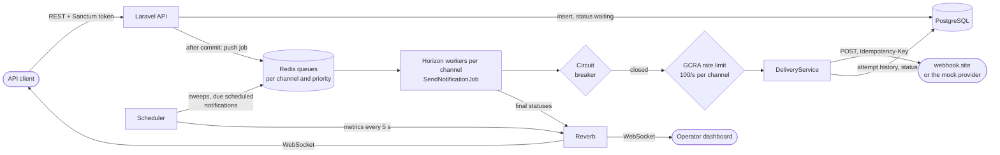
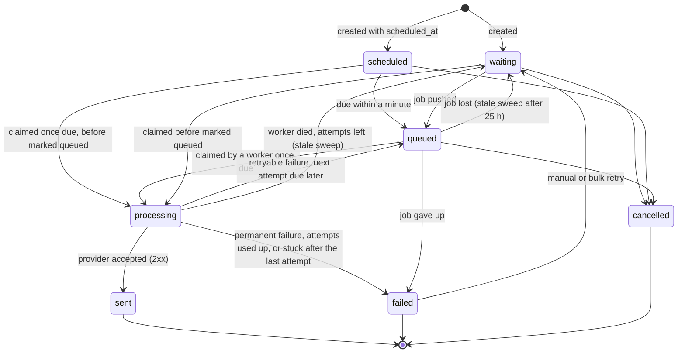

# EDNS — Event-Driven Notification System

[](https://github.com/MrKacmaz/ione-edns/actions/workflows/ci.yml)

A Laravel 13 / PHP 8.5 service that accepts notification requests over a REST API and delivers them asynchronously as **SMS, email and push** messages through an external provider. Delivery runs on prioritised queues with a per-channel rate limit, retries with backoff, a circuit breaker, idempotency at three levels, scheduled sending, templates, real-time status updates over WebSockets, and metrics, structured logs, health checks and distributed tracing.

## Contents

- [Requirements coverage](#requirements-coverage)
- [Quick start with Docker](#quick-start-with-docker)
- [Provider setup (webhook.site)](#provider-setup-webhooksite)
- [Local development without Docker](#local-development-without-docker)
- [Architecture](#architecture)
- [Delivery and retry logic](#delivery-and-retry-logic)
- [Design decisions](#design-decisions)
- [API](#api)
- [Postman](#postman)
- [Real-time updates](#real-time-updates)
- [Observability](#observability)
- [Configuration](#configuration)
- [Tests and code quality](#tests-and-code-quality)
- [CI/CD](#cicd)
- [Project structure](#project-structure)
- [Known limitations](#known-limitations)

## Requirements coverage

| Requirement                                                  | Where                                                                                                                                                                                                   |
| ------------------------------------------------------------ | ------------------------------------------------------------------------------------------------------------------------------------------------------------------------------------------------------- |
| Create notifications (recipient, channel, content, priority) | `POST /api/v1/notifications` — `NotificationController`, `CreateNotificationsAction`                                                                                                                    |
| Batches of up to 1000                                        | `POST /api/v1/notifications/batch` — all-or-nothing validation, `notifications.batch.max_size`                                                                                                          |
| Status by id or batch id                                     | `GET /api/v1/notifications/{id}`, `GET /api/v1/batches/{id}` (counts per status)                                                                                                                        |
| Cancel pending notifications                                 | `POST /api/v1/notifications/{id}/cancel`, `POST /api/v1/batches/{id}/cancel`                                                                                                                            |
| Filtered, paginated list                                     | `GET /api/v1/notifications?status=&channel=&batch_id=&created_from=&created_to=` with cursor pagination                                                                                                 |
| Asynchronous processing                                      | Redis queues worked by Laravel Horizon — `SendNotificationJob`, `DeliveryService`                                                                                                                       |
| 100 messages per second per channel                          | Own GCRA limiter in Redis — `RedisGcraRateLimiter` ([ADR 0003](docs/adr/0003-gcra-rate-limiter-per-channel.md))                                                                                         |
| Priority queues (high, normal, low)                          | Strict-order Horizon supervisor plus a low-priority floor ([ADR 0002](docs/adr/0002-priority-queues-on-horizon.md))                                                                                     |
| Content validation                                           | Per-channel recipient formats and length limits — `Services/Delivery/Channels/*Channel`                                                                                                                 |
| Idempotency                                                  | `Idempotency-Key` header, per-notification `idempotency_key`, atomic claim ([ADR 0004](docs/adr/0004-delivery-guarantees-and-idempotency.md))                                                           |
| Delivery and retry logic                                     | Retryable vs permanent failures, exponential backoff with full jitter, `Retry-After`, manual retry ([section](#delivery-and-retry-logic), [ADR 0005](docs/adr/0005-retries-and-failure-handling.md))    |
| Real-time metrics                                            | `GET /api/v1/metrics`: queue depth, success rate, latency percentiles                                                                                                                                   |
| Structured logs with correlation ids                         | JSON logs, `X-Correlation-ID` carried into jobs and to the provider                                                                                                                                     |
| Health check                                                 | `GET /health`                                                                                                                                                                                           |
| webhook.site provider                                        | `WebhookSiteGateway`, URL in `NOTIFICATIONS_GATEWAY_URL` ([setup](#provider-setup-webhooksite)); a local mock provider until it is set                                                                  |
| **Bonus:** failure handling                                  | Per-channel circuit breaker, operator alert mails, outbox sweeps ([ADR 0005](docs/adr/0005-retries-and-failure-handling.md))                                                                            |
| **Bonus:** scheduled notifications                           | `scheduled_at` up to 30 days ahead ([ADR 0006](docs/adr/0006-scheduled-notifications.md))                                                                                                               |
| **Bonus:** templates                                         | `/api/v1/templates`, `{{ variable }}` placeholders ([ADR 0007](docs/adr/0007-templates-rendered-at-creation.md))                                                                                        |
| **Bonus:** WebSocket updates                                 | Laravel Reverb: status events for API clients, live operator dashboard ([ADR 0008](docs/adr/0008-real-time-updates-and-observability.md))                                                               |
| **Bonus:** distributed tracing                               | OpenTelemetry auto-instrumentation exported to Jaeger                                                                                                                                                   |
| **Bonus:** CI/CD                                             | GitHub Actions: quality checks, the tests against PostgreSQL and Redis, an end-to-end run of the Docker stack, then images published to GitHub Container Registry and releases on tags ([CI/CD](#cicd)) |
| Docker Compose, OpenAPI, migrations, tests                   | `docker-compose.yml`, `spec/openapi.json` with Postman collections in `postman/`, `database/migrations`, Pest tests                                                                                     |

## Quick start with Docker

Requirements: Docker with Compose v2. PHP, Composer, Node, PostgreSQL and Redis all run in containers.

**1. Point the service at your provider URL.** Create a webhook.site URL that answers `202` as described in [Provider setup](#provider-setup-webhooksite), then write it into a `.env` file next to `docker-compose.yml`:

```bash
echo 'NOTIFICATIONS_GATEWAY_URL=https://webhook.site/<your-uuid>' >> .env
```

This step is optional: without a URL the stack delivers to its own mock provider, an nginx container that accepts every notification the way webhook.site does, so nothing reaches the outside world.

**2. Start everything** with one command:

```bash
docker compose up -d --build
```

The first start builds the images. The one-off `init` service then creates the secrets (`APP_KEY`, the Reverb secret), **runs the migrations** and seeds an operator account with two templates, and every other service waits for it. There is no manual setup step.

| Service                        | URL                                                                                     |
| ------------------------------ | --------------------------------------------------------------------------------------- |
| API                            | http://localhost:8000/api/v1                                                            |
| Operator dashboard             | http://localhost:8000 — sign in as `test@example.com` / `password`                      |
| API documentation (Swagger UI) | http://localhost:8000/docs/api — raw OpenAPI 3.1 at http://localhost:8000/docs/api.json |
| Health                         | http://localhost:8000/health                                                            |
| Horizon                        | http://localhost:8000/horizon (operators only)                                          |
| Jaeger (traces)                | http://localhost:16686                                                                  |
| Mailpit (operator alert mails) | http://localhost:8025                                                                   |
| Reverb (WebSocket)             | ws://localhost:8080                                                                     |

Host ports can be changed with `APP_PORT`, `REVERB_HOST_PORT`, `JAEGER_UI_PORT` and `MAILPIT_UI_PORT`.

**3. Get the API token** that the seeder created, and send a first notification:

```bash
TOKEN=$(docker compose logs --no-log-prefix init | sed -n 's/.*API token for [^:]*: //p' | tail -1)
```

```bash
curl -s -X POST http://localhost:8000/api/v1/notifications \
  -H "Authorization: Bearer $TOKEN" -H 'Content-Type: application/json' -H 'Accept: application/json' \
  -d '{"recipient": "+905551234567", "channel": "sms", "content": "Hello from EDNS"}'
```

The request shows up in your webhook.site inbox within a few seconds (with the mock provider, in `docker compose logs provider`), and `GET /api/v1/notifications/{id}` reports `"status": "sent"`.

**Run the whole test suite** in Docker, against its own database, with one command:

```bash
docker compose --profile test run --rm tests
```

**Stop**, or stop and delete all data (database, queues, secrets):

```bash
docker compose down
```

```bash
docker compose down -v
```

## Provider setup (webhook.site)

The provider is simulated by [webhook.site](https://webhook.site). The service posts every notification to `NOTIFICATIONS_GATEWAY_URL` and expects the answer the task describes:

```
202 Accepted
{"messageId": "...", "status": "accepted", "timestamp": "..."}
```

1. Open https://webhook.site. It creates a unique URL at once (`https://webhook.site/<uuid>`); copy it.
2. Click **Edit** at the top of the page and set:
    - **Default status code:** `202`
    - **Content type:** `application/json`
    - **Response body:**
        ```json
        {
            "messageId": "7f3c2a1e-0b6d-4c8e-9a51-3d2f6e8b9c40",
            "status": "accepted",
            "timestamp": "2026-11-14T00:00:00Z"
        }
        ```
3. Save, then set the URL in `.env` next to `docker-compose.yml` (or in the Laravel `.env` without Docker):
    ```bash
    NOTIFICATIONS_GATEWAY_URL=https://webhook.site/<your-uuid>
    ```
4. Apply it. Compose recreates the containers whose environment changed:
    ```bash
    docker compose up -d
    ```
5. Check it: `curl -s http://localhost:8000/health` reports `"gateway": {"status": "ok"}`. Every delivery appears in the webhook.site inbox with the headers `Idempotency-Key` (the notification id), `X-Correlation-ID` and, while tracing is on, `traceparent`.

The `messageId` matters: any `2xx` counts as accepted only when the body carries a `messageId`. Without one the provider has not confirmed the message, so the notification fails (see [Delivery and retry logic](#delivery-and-retry-logic)).

A free webhook.site URL expires after seven days and accepts a limited number of requests. When it stops working, create a new one, replace the line in `.env` and run `docker compose up -d` again. Notifications that failed in the meantime can be sent again with `POST /api/v1/notifications/{id}/retry`.

Without `NOTIFICATIONS_GATEWAY_URL` the Compose stack uses its **mock provider** instead: the `provider` service (nginx, [`docker/mock-provider/default.conf`](docker/mock-provider/default.conf)) answers every delivery with `202` and a fresh `messageId`. CI runs the stack this way. Remove the line from `.env` and run `docker compose up -d` to switch back to it.

## Local development without Docker

Requirements: PHP 8.5 with `pdo_pgsql`, `redis` (phpredis), `intl` and `pcntl`; PostgreSQL 18; Redis; Node 22. The `opentelemetry` extension is optional.

```bash
composer install
cp .env.example .env
php artisan key:generate
```

Set the `DB_*` values and `NOTIFICATIONS_GATEWAY_URL` in `.env`, then:

```bash
php artisan migrate --seed
npm install && npm run build
```

Run the four processes, each in its own terminal:

```bash
php artisan serve
```

```bash
php artisan horizon
```

```bash
php artisan schedule:work
```

```bash
php artisan reverb:start
```

## Architecture



A request is validated, stored in one transaction and answered with `202 Accepted`. Only after the commit are the jobs pushed onto the queue of each notification's channel and priority, for example `notifications-sms-high`; every channel has its own workers, so one channel waiting for send slots never holds up another ([ADR 0002](docs/adr/0002-priority-queues-on-horizon.md)). A Horizon worker passes each job through its middlewares: a guard that waits out database and Redis outages, the channel's circuit breaker, then its rate limiter. `DeliveryService` then claims the notification atomically, calls the provider, records the attempt and moves the notification to its next status. The scheduler repairs anything that fell between the database and Redis, queues scheduled notifications shortly before their time, and pushes metrics to the dashboard.

### Notification lifecycle



### Components

| Concern                                 | Code                                                                                                                             |
| --------------------------------------- | -------------------------------------------------------------------------------------------------------------------------------- |
| HTTP API                                | `app/Http/Controllers`, `app/Http/Requests`, `app/Http/Resources`, `routes/api.php` (mounted at `api/v1` in `bootstrap/app.php`) |
| Creating and queueing                   | `app/Actions/CreateNotificationsAction.php`, `app/Actions/DispatchNotificationsAction.php`                                       |
| Delivery                                | `app/Jobs/SendNotificationJob.php`, `app/Jobs/Middleware/*`, `app/Services/Delivery/DeliveryService.php`                         |
| Queues and workers                      | `NotificationPriority::queueFor()`, `config/horizon.php` (supervisors per channel)                                               |
| Channels (strategy + registry)          | `app/Services/Delivery/Channels/*Channel.php`, `ChannelRegistry.php`                                                             |
| Provider                                | `app/Services/Delivery/Gateways/WebhookSiteGateway.php`                                                                          |
| Rate limiting, retries, circuit breaker | `RateLimiting/RedisGcraRateLimiter.php`, `RetryBackoff.php`, `CircuitBreaking/RedisCircuitBreaker.php`                           |
| Scheduled work                          | `app/Console/Commands/*`, `routes/console.php`                                                                                   |
| Real time                               | `app/Events/*`, `routes/channels.php`, `resources/js/pages/Dashboard.vue`                                                        |
| Observability                           | `app/Services/Observability/*`, `app/Http/Middleware/AssignRequestContext.php`                                                   |

## Delivery and retry logic

The task leaves this part to the candidate. The approach in one sentence: **classify every provider answer as accepted, retryable or permanent, retry only what can still succeed, spread retries with exponential backoff and full jitter, never let waiting use up attempts, and stop calling a provider that is down.** The full reasoning, with the options that were rejected, is in [ADR 0004](docs/adr/0004-delivery-guarantees-and-idempotency.md) and [ADR 0005](docs/adr/0005-retries-and-failure-handling.md).

### One delivery attempt

1. The job passes the channel's **circuit breaker**, then the **rate limiter** (100 messages a second per channel). Neither counts as an attempt: an open circuit or a full second only delays the job.
2. `DeliveryService` **claims** the notification with one conditional `UPDATE` to `processing` and counts the attempt, but only once it is due: not before its next attempt after a failure (`next_attempt_at`) and not before its `scheduled_at`. A job that comes early is released until then; a duplicate job, or a job for a cancelled notification, claims nothing and stops.
3. `WebhookSiteGateway` posts `{to, channel, content}` with `Idempotency-Key: <notification id>`, `X-Correlation-ID` and the trace context (`traceparent`), with a 5-second connect timeout and a 10-second request timeout.
4. The answer is **classified**. The attempt (HTTP status, error, duration) and the notification's new status are written in one transaction.

### Transient vs permanent failures

| Provider answer                     | Classified as | What happens                                      | Why                                                                                                                                                                                                                                         |
| ----------------------------------- | ------------- | ------------------------------------------------- | ------------------------------------------------------------------------------------------------------------------------------------------------------------------------------------------------------------------------------------------- |
| `2xx` with a `messageId`            | accepted      | `sent`, the `messageId` is stored                 | The provider confirmed the message.                                                                                                                                                                                                         |
| `2xx` without a `messageId`         | permanent     | `failed` at once                                  | The message was not confirmed, and a misconfigured endpoint will not start answering correctly on a retry.                                                                                                                                  |
| Timeout or connection error         | retryable     | Retried with backoff                              | The provider or the network is briefly unavailable; the same request can succeed a moment later.                                                                                                                                            |
| `408`, `429`, `5xx`                 | retryable     | Retried with backoff, `Retry-After` honoured      | HTTP defines these as "try again later": a timeout, throttling, or a server-side fault.                                                                                                                                                     |
| `401`, `403`, `404`, `410`          | retryable     | Retried with backoff, counts against the circuit  | The endpoint or its credentials are wrong (for example an expired webhook.site URL), not the message. Every message would get the same answer, so the circuit opens and alerts the operators instead of every notification failing quietly. |
| Any other `4xx` (`400`, `422`, …)   | permanent     | `failed` at once, with the status in `last_error` | The request itself is rejected. Sending it again gives the same answer and wastes the rate limit and the provider's capacity.                                                                                                               |
| An unexpected error in our own code | retryable     | Retried with backoff, and reported                | The notification is already claimed; letting the error escape would leave it stuck in `processing`.                                                                                                                                         |

### Backoff: exponential with full jitter

After the n-th failed attempt the next one waits a **random** time between zero and `min(300, 30 × 2^(n−1))` seconds, and at least one second:

| Failed attempts | Next attempt within      |
| --------------- | ------------------------ |
| 1               | 0–30 s                   |
| 2               | 0–60 s                   |
| 3               | 0–120 s                  |
| 4               | 0–240 s                  |
| 5               | — the notification fails |

A provider's `Retry-After` (delay seconds or an HTTP date, parsed strictly) is a lower bound for the wait, capped at one hour so a wrong header cannot park a notification for days. Without `Retry-After`, the defaults give up on a notification after at most about 7.5 minutes of waiting. Everything is configurable (`NOTIFICATIONS_MAX_ATTEMPTS`, `NOTIFICATIONS_BACKOFF_*`).

**Why full jitter:** when the provider has a problem, many notifications fail in the same second. Plain exponential backoff would send them all back in the same second again and hit the recovering provider with the same spike. Spreading each retry randomly over its window removes the spike without any coordination between workers.

### How retries run

- **A retry releases the same job with the computed delay.** It does not count as a new Laravel attempt. The notification's own `attempts` counter decides when to stop, so waiting for a rate-limit slot or for an open circuit never uses up attempts. Meanwhile the notification is `queued` with the reason in `last_error` and the time of the next attempt in `next_attempt_at`, so no duplicate job can run it sooner. Every call is kept in `notification_attempts`.
- **A database or Redis outage** does not use up anything: the job goes back to the queue after 10 seconds, doubling up to five minutes, until the outage ends or the job's one-day lifetime is over. API requests that meet the outage are answered with `503` and `Retry-After: 10` instead of `500`. Other unexpected errors are retried by Laravel after 10, 30, 60 and 120 seconds, at most five times. When a job gives up, its notification is marked `failed` rather than left behind.
- **Errors shown to clients are generic** ("The provider could not be reached."): the underlying exception names the provider URL, which with webhook.site is the secret that protects the messages. The full message is in the log.
- **Manual retry:** `POST /api/v1/notifications/{id}/retry` gives a `failed` notification a fresh set of attempts and keeps its history.
- **Bulk retry after an incident:** `php artisan notifications:retry-failed "2 hours ago"` does the same for every notification that failed since then (`--channel=sms` to narrow it, `--dry-run` to count first). In Docker: `docker compose exec app php artisan notifications:retry-failed "2 hours ago"`.

### When the provider is down: circuit breaker

Retrying every notification on its own schedule keeps hammering a provider that is down and burns every notification's attempts. So each channel has a **circuit breaker** shared in Redis:

- It **opens** when, over the last 60 seconds, at least 20 calls were made and at least 50% of them failed in a retryable way. Permanent failures count as healthy calls, because the provider did answer.
- While it is open, jobs wait without calling the provider and without using attempts. Each job waits the circuit's remaining time plus a random extra of up to the same length, so the jobs held back together come back spread out rather than in the same second.
- After 30 seconds a single **probe** call decides: success closes the circuit, failure opens it again.
- Each change is logged, broadcast to the dashboard and mailed to the operators (throttled). `/health` reports `warn` while a circuit is open.

### Nothing lost, duplicates kept to a minimum

- A notification is stored before its job is pushed, and the push happens only after the commit. Every minute a sweep repairs the gaps: it pushes `waiting` notifications older than 2 minutes again, returns `processing` ones untouched for 5 minutes (a dead worker) to `waiting`, and pushes `queued` ones whose job was lost again after 25 hours.
- Delivery to the provider is **at-least-once**. If a worker dies, or the database goes away, after the provider accepted a message but before the result was recorded, the message is sent again. Every attempt carries `Idempotency-Key: <notification id>`, so a provider that honours the header drops the duplicate. The provider's answer is logged as `notification.delivery.unrecorded` in that case.
- Each resend uses up an attempt, so a notification is sent at most five times even when its outcome can never be recorded. A notification stuck in `processing` after its last attempt **fails** instead of being sent again, with the reason that the provider may have received it.

### Try it

Change the **default status code** of your webhook.site URL, send a notification and follow it with `GET /api/v1/notifications/{id}` (`attempts`, `last_error`, `status`) and `docker compose logs -f horizon` (`notification.delivery.retry_scheduled`):

- `500`, `503` or `429`: the notification is retried with growing gaps and fails after the fifth attempt, a few minutes later.
- `404`: the same, as for an expired URL; with 20 or more calls a minute the channel's circuit opens and the alert mail appears in Mailpit.
- `400`: it fails at once with "The provider responded with HTTP 400." as the error.
- `202` with an empty body: it fails at once as unconfirmed.
- Set it back to `202` with the body above, then `POST /api/v1/notifications/{id}/retry`: it is sent.

## Design decisions

Each decision is recorded as an ADR in [`docs/adr`](docs/adr):

| ADR                                                                              | Decision                                                                                                                                            |
| -------------------------------------------------------------------------------- | --------------------------------------------------------------------------------------------------------------------------------------------------- |
| [0001](docs/adr/0001-own-notification-model-instead-of-laravel-notifications.md) | An own `Notification` model and delivery pipeline instead of Laravel Notifications, because every requirement needs stored, queryable state.        |
| [0002](docs/adr/0002-priority-queues-on-horizon.md)                              | Queues and workers per channel and priority, drained in strict order, plus workers that serve only normal or only low so neither starves.           |
| [0003](docs/adr/0003-gcra-rate-limiter-per-channel.md)                           | A GCRA rate limiter in Redis: evenly spaced sends, never more than 100 in any second, short waits kept in place.                                    |
| [0004](docs/adr/0004-delivery-guarantees-and-idempotency.md)                     | `waiting` as an outbox state, after-commit dispatch, stale sweeps, outages waited out, and idempotency at request, notification and delivery level. |
| [0005](docs/adr/0005-retries-and-failure-handling.md)                            | Retryable vs permanent failures, full-jitter backoff, a capped `Retry-After`, and a per-channel circuit breaker with operator alerts.               |
| [0006](docs/adr/0006-scheduled-notifications.md)                                 | Scheduled notifications stay in the database until a minute before their time, then go out as delayed jobs.                                         |
| [0007](docs/adr/0007-templates-rendered-at-creation.md)                          | Templates are rendered strictly when a notification is created, and the text is stored on the notification.                                         |
| [0008](docs/adr/0008-real-time-updates-and-observability.md)                     | Final statuses over WebSockets, a live operator dashboard, correlation ids, tracing, metrics and health.                                            |

## API

All endpoints live under `/api/v1` and need a Sanctum bearer token. Requests and responses are JSON. Every account may make 600 requests a minute, shared by all of its tokens; further requests answer `429` with a `Retry-After` header. A request body may be up to 25 MB, enough for a batch of 1000 long emails; a larger one answers `413`. The full specification is in [`spec/openapi.json`](spec/openapi.json), browsable at `/docs/api`, and every endpoint is also in the [Postman](#postman) collections.

```bash
API=http://localhost:8000/api/v1
H=(-H "Authorization: Bearer $TOKEN" -H 'Accept: application/json' -H 'Content-Type: application/json')
```

**Create a notification:**

```bash
curl -s "${H[@]}" -X POST "$API/notifications" -d '{
  "channel": "sms",
  "recipient": "+905551234567",
  "content": "Flash sale starts now!",
  "priority": "high",
  "idempotency_key": "flash-sale-2026-11-14-user-42"
}'
```

The answer is `202 Accepted` with the notification in `"status": "queued"`, or `"waiting"` when the request carries an `Idempotency-Key` header: such a request is committed together with its stored response, and the job is pushed only after that commit (a scheduled notification answers `"scheduled"` either way). Sending the same `idempotency_key` with the same notification again returns the existing one with `200`; with a different channel, recipient, content, priority or schedule it answers `422`.

| Channel | Recipient                                | Content limit     |
| ------- | ---------------------------------------- | ----------------- |
| `sms`   | E.164 phone number, e.g. `+905551234567` | 160 characters    |
| `email` | Email address                            | 10,000 characters |
| `push`  | Device token, 16 to 512 characters       | 240 characters    |

**Make a retried request safe** with the `Idempotency-Key` header: a retry with the same key and payload replays the first response (`Idempotent-Replayed: true`). A different payload answers `422`, a request while the first is still running answers `409`. **Follow a request** with `X-Correlation-ID` (a UUID); it is echoed back and appears in the logs, the jobs and the provider call.

```bash
curl -s "${H[@]}" -X POST "$API/notifications" \
  -H 'Idempotency-Key: 8d3f1c7e-2b4a-4f0e-9c61-5a7b2e9d1f30' \
  -H 'X-Correlation-ID: 0b9e8c1a-4d2f-4e7b-8a3c-6f1d2e9b7a54' \
  -d '{"channel": "email", "recipient": "customer@example.com", "content": "Your invoice is ready."}'
```

**Create a batch** of up to 1000 notifications. One invalid item rejects the whole batch with `422` and indexed errors (`notifications.3.recipient`).

```bash
curl -s "${H[@]}" -X POST "$API/notifications/batch" -d '{
  "notifications": [
    {"channel": "sms", "recipient": "+905551234567", "content": "Your order has shipped."},
    {"channel": "push", "recipient": "a1b2c3d4e5f6a7b8c9d0", "content": "New message", "priority": "low"}
  ]
}'
```

**Schedule** a notification up to 30 days ahead. `scheduled_at` is an ISO 8601 date-time; one without an offset is UTC.

```bash
curl -s "${H[@]}" -X POST "$API/notifications" -d '{
  "channel": "sms", "recipient": "+905551234567", "content": "Your appointment is tomorrow.",
  "scheduled_at": "2026-11-20T09:00:00+03:00"
}'
```

**Templates:** create one, then send by name with variables.

```bash
curl -s "${H[@]}" -X POST "$API/templates" -d '{
  "name": "order-shipped", "channel": "sms",
  "content": "Hi {{ name }}, your order {{ order_id }} has shipped."
}'
```

```bash
curl -s "${H[@]}" -X POST "$API/notifications" -d '{
  "channel": "sms", "recipient": "+905551234567",
  "template": "order-shipped", "variables": {"name": "Ada", "order_id": 1001}
}'
```

A template's content may hold up to 10,000 characters, placeholders included; its fixed text must fit the channel's limit, and so must every notification rendered from it.

**Query, list, cancel and retry:**

```bash
curl -s "${H[@]}" "$API/notifications/{id}"
```

```bash
curl -s "${H[@]}" "$API/batches/{id}"
```

```bash
curl -s "${H[@]}" "$API/notifications?status=failed&channel=sms&created_from=2026-11-14&per_page=50"
```

```bash
curl -s "${H[@]}" -X POST "$API/notifications/{id}/cancel"
```

```bash
curl -s "${H[@]}" -X POST "$API/batches/{id}/cancel"
```

```bash
curl -s "${H[@]}" -X POST "$API/notifications/{id}/retry"
```

The list is cursor-paginated: follow `links.next` or pass `meta.next_cursor` as `cursor`. `created_from` and `created_to` take an ISO 8601 date (`2026-11-14`) or date-time (`2026-11-14T09:30:00+03:00`), compared in UTC; relative phrases such as `tomorrow` are rejected. A bare date in `created_to` includes that whole day, so `created_from=2026-11-14T10:00:00Z&created_to=2026-11-14` lists the rest of that day. Cancelling is safe to repeat: a notification that is already cancelled answers `200` again, unchanged. Templates are managed with `GET|POST /templates` and `GET|PATCH|DELETE /templates/{id}`.

| Status | Meaning                                                                                                    |
| ------ | ---------------------------------------------------------------------------------------------------------- |
| `202`  | Accepted for asynchronous delivery (create, batch, retry)                                                  |
| `200`  | Read, cancelled (also again), or an idempotency key that was already used                                  |
| `400`  | Malformed `Idempotency-Key` header                                                                         |
| `401`  | Missing or invalid token                                                                                   |
| `403`  | Not an operator (metrics)                                                                                  |
| `404`  | Unknown id, or a record of another user                                                                    |
| `409`  | Already processing or finished (cancel), not failed (retry); an idempotent request still in progress       |
| `422`  | Validation error, or an `Idempotency-Key` reused with another payload                                      |
| `429`  | Too many requests from the account this minute; wait for `Retry-After` seconds                             |
| `503`  | The database or Redis cannot be reached right now; send the request again after `Retry-After` (10) seconds |

## Postman

The `postman/` folder holds Postman collections in Postman's local, file-based format:

| Path                                               | Content                                                                                                                                                                             |
| -------------------------------------------------- | ----------------------------------------------------------------------------------------------------------------------------------------------------------------------------------- |
| `postman/collections/EDNS API`                     | Every endpoint, generated from `spec/openapi.json` and grouped like the API documentation                                                                                           |
| `postman/collections/EDNS Smoke Flow`              | An end-to-end check in 18 tested steps: health, templates, scheduling, idempotent replay, cancellation, batches, validation, one real delivery, metrics and WebSocket authorization |
| `postman/environments/EDNS Local.environment.yaml` | `appUrl`, `baseUrl` and an empty `bearerToken`                                                                                                                                      |

In the Postman app, open the repository folder to work with them, and set `bearerToken` in the "EDNS Local" environment to your API token. Keep the token out of the committed file.

Run the smoke flow from the command line with the [Postman CLI](https://learning.postman.com/docs/postman-cli/postman-cli-overview/). Only one step reaches the provider; the other notifications are scheduled a day ahead and cancelled.

```bash
postman collection run "postman/collections/EDNS Smoke Flow" -e "postman/environments/EDNS Local.environment.yaml" --env-var "bearerToken=$TOKEN"
```

After an API change, regenerate the specification and the API collection with one command (`.postman/workflows.yaml` records the same sync for the Postman app):

```bash
composer postman:sync
```

It exports `spec/openapi.json` with Scramble, generates the "EDNS API" collection from it with the Postman CLI, and trims the list requests to `per_page=25`, because the generator fills every optional filter with a placeholder.

The generated create requests share one example `Idempotency-Key`, so sending one twice replays the first response; change or disable the header to create another notification.

## Real-time updates

When a notification reaches `sent`, `failed` or `cancelled`, its owner receives a `.notification.status-changed` event on the private channel `App.Models.User.{id}`. API clients authorize the channel with their token at `/api/v1/broadcasting/auth`. With Laravel Echo:

```js
import Echo from 'laravel-echo';
import Pusher from 'pusher-js';

window.Pusher = Pusher;

const echo = new Echo({
    broadcaster: 'reverb',
    key: 'edns-local-key',
    wsHost: 'localhost',
    wsPort: 8080,
    forceTLS: false,
    enabledTransports: ['ws'],
    authEndpoint: 'http://localhost:8000/api/v1/broadcasting/auth',
    auth: { headers: { Authorization: `Bearer ${token}` } },
});

echo.private(`App.Models.User.${userId}`) // userId: data.id of GET /api/v1/user
    .listen('.notification.status-changed', (event) =>
        console.log(event.notification),
    );
```

The operator dashboard at http://localhost:8000 shows queue depth, success rate, latency, circuit states and the signed-in operator's latest notifications. It is updated every five seconds and on every circuit change.

## Observability

- **Metrics:** `GET /api/v1/metrics` (operators only) returns queue depth per channel and priority, notifications per unfinished status, attempts, success rate and p50/p95/p99 provider and end-to-end latency over the last 5 minutes and hour, and each channel's circuit state.
- **Health:** `GET /health` (no token) checks the database, Redis, Horizon, the gateway configuration and the delivery circuits. It answers `200` with `ok`, `200` with `warn` while a circuit is open, and `503` with `fail`. It reports whether the system delivers notifications, so it fails, for example, while Horizon is down although the API still answers. A load balancer or orchestrator deciding whether a container is alive should use Laravel's `GET /up`, which only checks that the application boots (the Compose `web` health check does).
- **Logs:** JSON lines (`LOG_FORMAT=line` for plain text) such as `notification.delivery.sent`, `notification.delivery.retry_scheduled` and `notification.circuit.opened`, each with the notification and correlation ids and the trace id. Every delivery job carries its notification's id and correlation id from the moment it is pushed, also when the stale sweep or the scheduler pushes it, so waits for a send slot or an open circuit can be found by either id too. A delivery job logs its own trace id and keeps the creating request's as `request_trace_id`. In Docker: `docker compose logs -f horizon`.
- **Traces:** OpenTelemetry traces of requests, queries, HTTP calls and jobs in Jaeger (service `ione-edns`). Each delivery job has its own trace, linked to the request that created it. The provider call carries the job's trace context in the W3C `traceparent` header, so a provider that traces too continues the same trace.
- **Queues:** Horizon at `/horizon`, for operators only.
- **Alerts:** when a channel's circuit opens or closes, operators listed in `NOTIFICATIONS_ALERT_MAIL_TO` are mailed. In Docker the mails land in Mailpit.

## Configuration

Everything is set with environment variables (see `.env.example` and `config/notifications.php`).

| Variable                                        | Default | Meaning                                                                                                      |
| ----------------------------------------------- | ------- | ------------------------------------------------------------------------------------------------------------ |
| `NOTIFICATIONS_GATEWAY_URL`                     | —       | The provider (webhook.site) URL; Docker Compose falls back to its mock provider                              |
| `NOTIFICATIONS_GATEWAY_TIMEOUT_SECONDS`         | 10      | Provider request timeout                                                                                     |
| `NOTIFICATIONS_GATEWAY_CONNECT_TIMEOUT_SECONDS` | 5       | Provider connect timeout                                                                                     |
| `NOTIFICATIONS_BATCH_MAX_SIZE`                  | 1000    | Most notifications per batch                                                                                 |
| `NOTIFICATIONS_SCHEDULE_MAX_DAYS`               | 30      | How far ahead `scheduled_at` may be                                                                          |
| `NOTIFICATIONS_IDEMPOTENCY_RETENTION_HOURS`     | 24      | How long an `Idempotency-Key` response is replayed                                                           |
| `NOTIFICATIONS_IDEMPOTENCY_LOCK_SECONDS`        | 30      | How long a request holds its key while running                                                               |
| `NOTIFICATIONS_MAX_ATTEMPTS`                    | 5       | Provider attempts before a notification fails                                                                |
| `NOTIFICATIONS_BACKOFF_BASE_SECONDS`            | 30      | Backoff window after the first failure, doubling per attempt                                                 |
| `NOTIFICATIONS_BACKOFF_CAP_SECONDS`             | 300     | Longest backoff window                                                                                       |
| `NOTIFICATIONS_BACKOFF_MAX_RETRY_AFTER_SECONDS` | 3600    | Longest provider `Retry-After` that is honoured                                                              |
| `NOTIFICATIONS_RATE_LIMIT_PER_SECOND`           | 100     | Messages per second per channel                                                                              |
| `NOTIFICATIONS_RATE_LIMIT_MAX_WAIT_MS`          | 2000    | Longest in-place wait for a send slot                                                                        |
| `NOTIFICATIONS_STALE_WAITING_SECONDS`           | 120     | When a waiting notification is pushed again                                                                  |
| `NOTIFICATIONS_STALE_PROCESSING_SECONDS`        | 300     | When a processing notification is considered abandoned                                                       |
| `NOTIFICATIONS_STALE_QUEUED_SECONDS`            | 90000   | When a queued notification whose job was lost is pushed again; at least one day, past the job's retry window |
| `NOTIFICATIONS_CIRCUIT_WINDOW_SECONDS`          | 60      | Sliding window of the circuit breaker                                                                        |
| `NOTIFICATIONS_CIRCUIT_MINIMUM_ATTEMPTS`        | 20      | Calls in the window before a circuit can open                                                                |
| `NOTIFICATIONS_CIRCUIT_FAILURE_RATE_PERCENT`    | 50      | Retryable failure rate that opens a circuit                                                                  |
| `NOTIFICATIONS_CIRCUIT_COOLDOWN_SECONDS`        | 30      | How long a circuit stays open before a probe                                                                 |
| `NOTIFICATIONS_CIRCUIT_PROBE_TIMEOUT_SECONDS`   | 20      | When an unanswered probe is replaced                                                                         |
| `NOTIFICATIONS_ALERT_MAIL_TO`                   | —       | Comma-separated operator addresses for circuit alerts                                                        |
| `NOTIFICATIONS_ALERT_THROTTLE_MINUTES`          | 10      | Least time between two alerts for the same channel and change                                                |
| `NOTIFICATIONS_METRICS_CACHE_SECONDS`           | 5       | Cache lifetime of the metrics snapshot                                                                       |
| `NOTIFICATIONS_API_REQUESTS_PER_MINUTE`         | 600     | API requests per account and minute                                                                          |
| `HORIZON_NOTIFICATION_WORKERS`                  | 20      | Notification workers per channel in production (all priorities, strict order)                                |
| `HORIZON_NORMAL_PRIORITY_WORKERS`               | 2       | Workers per channel that serve only normal priority in production                                            |
| `HORIZON_LOW_PRIORITY_WORKERS`                  | 2       | Workers per channel that serve only low priority in production                                               |

## Tests and code quality

822 Pest tests: unit tests for pure logic (data objects, enums, backoff, channels), feature tests per class and endpoint, and architecture rules (`tests/Unit/ArchitectureTest.php`). Redis-backed code (rate limiter, circuit breaker, queues) is tested against a real Redis. [CI](#cicd) runs every check below and the whole suite on each push and pull request.

Run the tests in Docker:

```bash
docker compose --profile test run --rm tests
```

Run them locally (needs PostgreSQL with an `ione_edns_testing` database and Redis):

```bash
php artisan test
```

Run Pint, PHPStan and the tests together:

```bash
composer test
```

Static checks one by one:

```bash
vendor/bin/pint --test
```

```bash
vendor/bin/phpstan analyse
```

```bash
npm run check && npm run types:check
```

## CI/CD

GitHub Actions ([`.github/workflows/ci.yml`](.github/workflows/ci.yml)) runs on every push and pull request. A newer push to the same branch cancels the run still in progress.

| Job                     | What it does                                                                                                                                                                                                                                   |
| ----------------------- | ---------------------------------------------------------------------------------------------------------------------------------------------------------------------------------------------------------------------------------------------- |
| **Quality**             | Pint, PHPStan, the frontend build, formatting, lint and type checks, and `composer audit` / `npm audit` for known vulnerabilities                                                                                                              |
| **Tests**               | Migrates PostgreSQL 18, checks that `spec/openapi.json` matches the code, and runs the whole suite in random order against PostgreSQL and Redis (the same versions as Docker Compose). The output ends with the seed that reproduces the order |
| **End-to-end (Docker)** | Builds the images with Buildx (cached between runs), starts the full Compose stack, which delivers to its mock provider, waits for `/health` and runs the [Postman smoke flow](#postman). On failure the service logs are attached to the run  |
| **Publish**             | Only on pushes to `master` and `v*` tags, once the three jobs above passed. Pushes `ione-edns-app` and `ione-edns-web` to GitHub Container Registry and, for a tag, creates a GitHub release with generated notes                              |

**Images.** `master` is published as `latest`, a `v1.2.3` tag as `1.2.3`, and every image also as `sha-<commit>`:

```bash
docker pull ghcr.io/mrkacmaz/ione-edns-app:latest
```

The images are built with the Compose defaults (the dashboard reaches Reverb on `localhost:8080`).

**Releasing** is pushing a version tag:

```bash
git tag v1.0.0 && git push origin v1.0.0
```

**The mock provider** is the `provider` service of `docker-compose.yml`, an nginx container that accepts every delivery with `202` and a fresh `messageId`. CI sets no `NOTIFICATIONS_GATEWAY_URL`, so the stack delivers to it, just as locally without a webhook.site URL.

Dependabot ([`.github/dependabot.yml`](.github/dependabot.yml)) proposes weekly updates for the GitHub Actions, Composer and npm packages, and the Docker and Compose images; every action is pinned to a commit SHA.

## Project structure

```
app/
├── Actions/            create, dispatch, report circuit changes
├── Console/Commands/   sweeps, dispatch of due notifications, metrics broadcast
├── Data/               immutable value objects (*Data)
├── Enums/              statuses, channels, priorities, outcomes
├── Events/             broadcast events
├── Http/               controllers, requests, resources, middleware, pagination, API docs
├── Jobs/               SendNotificationJob and its middleware
├── Models/             Notification, NotificationBatch, NotificationTemplate, ...
├── Rules/              validation rules
└── Services/
    ├── Delivery/       channels, gateway, rate limiter, backoff, circuit breaker
    └── Observability/  metrics, health checks
.github/                CI/CD workflow and Dependabot configuration
docker/                 nginx, PHP, entrypoint and init scripts, mock provider
docker-compose.yml      the full stack, with a mock provider until a provider URL is set
docs/adr/               architecture decision records
docs/backlog.md         planned and deferred work
postman/                Postman collections and environment (local, file-based format)
spec/openapi.json       OpenAPI specification (generated by Scramble)
tests/                  Pest unit, feature and architecture tests
```

## Known limitations

- **Deployment:** the pipeline publishes images and releases, but deploys them nowhere: there is no target environment. The images are built for `linux/amd64` only.
- **Provider:** the free webhook.site URL answers every request with the same `messageId`, expires after seven days and may limit the number of requests.
- **Delivery semantics:** delivery to the provider is at-least-once; duplicates are only dropped by a provider that honours the `Idempotency-Key`.
- **Docker defaults:** Docker Compose runs with `APP_ENV=local` and small worker pools; production needs real secrets, sized Horizon supervisors and trace sampling. The seeder creates the demo operator (`test@example.com` / `password`), its templates and a token only outside production; in production nothing is seeded.
- **Database connections:** every queue worker and every php-fpm process holds its own PostgreSQL connection. The production pools (24 notification workers for each of the three channels, up to 10 for broadcasts and other jobs, 20 php-fpm processes, the scheduler and Reverb) need about 105, above PostgreSQL's default `max_connections` of 100. A production database needs a higher limit or a connection pooler such as PgBouncer in front of it.
- **Redis is needed to accept notifications:** the API's rate limit and the `Idempotency-Key` lock live in Redis, so while Redis is down the API answers `503` with `Retry-After` instead of storing new notifications. Notifications stored before are not lost; the sweep pushes their jobs once Redis is back.
- **Worker capacity:** a worker waits for one provider call at a time, so a channel's throughput is about its workers ÷ provider latency. At 300 ms, the full 100 messages a second of a channel need about 30 workers (`HORIZON_NOTIFICATION_WORKERS`, per channel), on one machine or several.
- **Tenant fairness:** the API limits requests per account, not notifications, and the queues are shared by all accounts, so one account's large batches can delay another's notifications of the same channel and priority.

Planned and deferred work, with the reasons, is tracked in [`docs/backlog.md`](docs/backlog.md).
