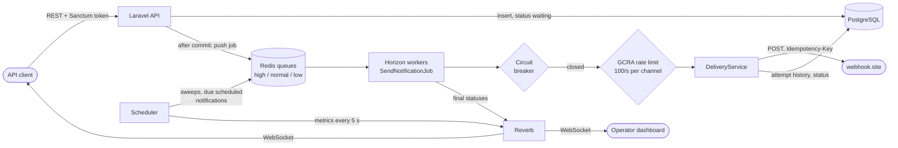
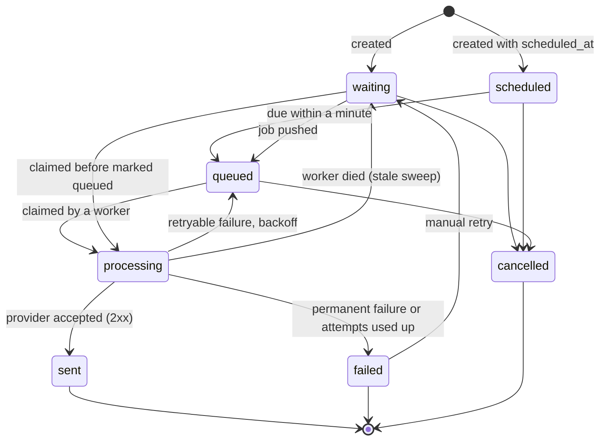

# EDNS — Event-Driven Notification System

A Laravel 13 / PHP 8.5 service that accepts notification requests over a REST API and delivers them asynchronously as **SMS, email and push** messages through an external provider. Delivery runs on prioritised queues with a per-channel rate limit, retries with backoff, a circuit breaker, idempotency at three levels, scheduled sending, templates, real-time status updates over WebSockets, and metrics, structured logs, health checks and distributed tracing.

## Contents

- [Requirements coverage](#requirements-coverage)
- [Quick start with Docker](#quick-start-with-docker)
- [Local development without Docker](#local-development-without-docker)
- [Architecture](#architecture)
- [Design decisions](#design-decisions)
- [API](#api)
- [Postman](#postman)
- [Real-time updates](#real-time-updates)
- [Observability](#observability)
- [Configuration](#configuration)
- [Tests and code quality](#tests-and-code-quality)
- [Project structure](#project-structure)
- [Known limitations](#known-limitations)

## Requirements coverage

| Requirement                                                  | Where                                                                                                                                                                         |
| ------------------------------------------------------------ | ----------------------------------------------------------------------------------------------------------------------------------------------------------------------------- |
| Create notifications (recipient, channel, content, priority) | `POST /api/v1/notifications` — `NotificationController`, `CreateNotificationsAction`                                                                                          |
| Batches of up to 1000                                        | `POST /api/v1/notifications/batch` — all-or-nothing validation, `notifications.batch.max_size`                                                                                |
| Status by id or batch id                                     | `GET /api/v1/notifications/{id}`, `GET /api/v1/batches/{id}` (counts per status)                                                                                              |
| Cancel pending notifications                                 | `POST /api/v1/notifications/{id}/cancel`, `POST /api/v1/batches/{id}/cancel`                                                                                                  |
| Filtered, paginated list                                     | `GET /api/v1/notifications?status=&channel=&batch_id=&created_from=&created_to=` with cursor pagination                                                                       |
| Asynchronous processing                                      | Redis queues worked by Laravel Horizon — `SendNotificationJob`, `DeliveryService`                                                                                             |
| 100 messages per second per channel                          | Own GCRA limiter in Redis — `RedisGcraRateLimiter` ([ADR 0003](docs/adr/0003-gcra-rate-limiter-per-channel.md))                                                               |
| Priority queues (high, normal, low)                          | Strict-order Horizon supervisor plus a low-priority floor ([ADR 0002](docs/adr/0002-priority-queues-on-horizon.md))                                                           |
| Content validation                                           | Per-channel recipient formats and length limits — `Services/Delivery/Channels/*Channel`                                                                                       |
| Idempotency                                                  | `Idempotency-Key` header, per-notification `idempotency_key`, atomic claim ([ADR 0004](docs/adr/0004-delivery-guarantees-and-idempotency.md))                                 |
| Delivery and retry logic                                     | Retryable vs permanent failures, exponential backoff with full jitter, `Retry-After`, manual retry ([ADR 0005](docs/adr/0005-retries-and-failure-handling.md))                |
| Real-time metrics                                            | `GET /api/v1/metrics` (JSON or Prometheus): queue depth, success rate, latency percentiles                                                                                    |
| Structured logs with correlation ids                         | JSON logs, `X-Correlation-ID` carried into jobs and to the provider                                                                                                           |
| Health check                                                 | `GET /health`                                                                                                                                                                 |
| webhook.site provider                                        | `WebhookSiteGateway`, URL in `NOTIFICATIONS_GATEWAY_URL`                                                                                                                      |
| **Bonus:** failure handling                                  | Per-channel circuit breaker, operator alert mails, outbox sweeps ([ADR 0005](docs/adr/0005-retries-and-failure-handling.md))                                                  |
| **Bonus:** scheduled notifications                           | `scheduled_at` up to 30 days ahead ([ADR 0006](docs/adr/0006-scheduled-notifications.md))                                                                                     |
| **Bonus:** templates                                         | `/api/v1/templates`, `{{ variable }}` placeholders ([ADR 0007](docs/adr/0007-templates-rendered-at-creation.md))                                                              |
| **Bonus:** WebSocket updates                                 | Laravel Reverb: status events for API clients, live operator dashboard ([ADR 0008](docs/adr/0008-real-time-updates-and-observability.md))                                     |
| **Bonus:** distributed tracing                               | OpenTelemetry auto-instrumentation exported to Jaeger                                                                                                                         |
| **Bonus:** CI/CD                                             | CI with GitHub Actions: formatting, linting, static analysis and the tests against PostgreSQL and Redis; no deployment pipeline (see [Known limitations](#known-limitations)) |
| Docker Compose, OpenAPI, migrations, tests                   | `docker-compose.yml`, `spec/openapi.json` with Postman collections in `postman/`, `database/migrations`, Pest tests                                                           |

## Quick start with Docker

Requirements: Docker with Compose v2.

```bash
docker compose up -d --build
```

The first start builds the images, creates the secrets (`APP_KEY`, the Reverb secret), runs the migrations and seeds an operator account with two templates.

| Service                        | URL                                                                |
| ------------------------------ | ------------------------------------------------------------------ |
| API                            | http://localhost:8000/api/v1                                       |
| Operator dashboard             | http://localhost:8000 — sign in as `test@example.com` / `password` |
| API documentation              | http://localhost:8000/docs/api                                     |
| Horizon                        | http://localhost:8000/horizon (operators only)                     |
| Jaeger (traces)                | http://localhost:16686                                             |
| Mailpit (operator alert mails) | http://localhost:8025                                              |
| Reverb (WebSocket)             | ws://localhost:8080                                                |

Host ports can be changed with `APP_PORT`, `REVERB_HOST_PORT`, `JAEGER_UI_PORT` and `MAILPIT_UI_PORT`.

**Get the API token** that the seeder created:

```bash
TOKEN=$(docker compose logs --no-log-prefix init | sed -n 's/.*API token for [^:]*: //p' | tail -1)
```

**Connect the provider.** Deliveries go to a [webhook.site](https://webhook.site) URL that simulates the provider. Without it every delivery fails and `/health` answers `503`.

1. Open https://webhook.site and copy your URL (`https://webhook.site/<uuid>`).
2. Under **Edit**, set the default status code to `202`, the content type to `application/json`, and the response body to:
    ```json
    {
        "messageId": "7f3c2a1e-0b6d-4c8e-9a51-3d2f6e8b9c40",
        "status": "accepted",
        "timestamp": "2026-11-14T00:00:00Z"
    }
    ```
3. Pass the URL to Compose, through a `.env` file next to `docker-compose.yml` or the shell, and restart:
    ```bash
    echo 'NOTIFICATIONS_GATEWAY_URL=https://webhook.site/<uuid>' >> .env
    docker compose up -d
    ```

**Run the tests in Docker** (against their own database):

```bash
docker compose --profile test run --rm tests
```

**Stop**, or stop and delete all data (database, queues, secrets):

```bash
docker compose down
```

```bash
docker compose down -v
```

## Local development without Docker

Requirements: PHP 8.5 with `pdo_pgsql`, `redis` (phpredis), `intl` and `pcntl`; PostgreSQL 18; Redis; Node 22. The `opentelemetry` extension is optional.

```bash
composer install
cp .env.example .env
php artisan key:generate
```

Set the `DB_*` values and `NOTIFICATIONS_GATEWAY_URL` in `.env`, then:

```bash
php artisan migrate --seed
npm install && npm run build
```

Run the four processes, each in its own terminal:

```bash
php artisan serve
```

```bash
php artisan horizon
```

```bash
php artisan schedule:work
```

```bash
php artisan reverb:start
```

## Architecture



A request is validated, stored in one transaction and answered with `202 Accepted`. Only after the commit are the jobs pushed onto the queue of each notification's priority. A Horizon worker passes each job through two middlewares: the channel's circuit breaker, then its rate limiter. `DeliveryService` then claims the notification atomically, calls the provider, records the attempt and moves the notification to its next status. The scheduler repairs anything that fell between the database and Redis, queues scheduled notifications shortly before their time, and pushes metrics to the dashboard.

### Notification lifecycle



### Components

| Concern                                 | Code                                                                                                                             |
| --------------------------------------- | -------------------------------------------------------------------------------------------------------------------------------- |
| HTTP API                                | `app/Http/Controllers`, `app/Http/Requests`, `app/Http/Resources`, `routes/api.php` (mounted at `api/v1` in `bootstrap/app.php`) |
| Creating and queueing                   | `app/Actions/CreateNotificationsAction.php`, `app/Actions/DispatchNotificationsAction.php`                                       |
| Delivery                                | `app/Jobs/SendNotificationJob.php`, `app/Jobs/Middleware/*`, `app/Services/Delivery/DeliveryService.php`                         |
| Channels (strategy + registry)          | `app/Services/Delivery/Channels/*Channel.php`, `ChannelRegistry.php`                                                             |
| Provider                                | `app/Services/Delivery/Gateways/WebhookSiteGateway.php`                                                                          |
| Rate limiting, retries, circuit breaker | `RateLimiting/RedisGcraRateLimiter.php`, `RetryBackoff.php`, `CircuitBreaking/RedisCircuitBreaker.php`                           |
| Scheduled work                          | `app/Console/Commands/*`, `routes/console.php`                                                                                   |
| Real time                               | `app/Events/*`, `routes/channels.php`, `resources/js/pages/Dashboard.vue`                                                        |
| Observability                           | `app/Services/Observability/*`, `app/Http/Middleware/AssignRequestContext.php`                                                   |

## Design decisions

Each decision is recorded as an ADR in [`docs/adr`](docs/adr):

| ADR                                                                              | Decision                                                                                                                                     |
| -------------------------------------------------------------------------------- | -------------------------------------------------------------------------------------------------------------------------------------------- |
| [0001](docs/adr/0001-own-notification-model-instead-of-laravel-notifications.md) | An own `Notification` model and delivery pipeline instead of Laravel Notifications, because every requirement needs stored, queryable state. |
| [0002](docs/adr/0002-priority-queues-on-horizon.md)                              | One queue per priority, drained in strict order, plus one worker that only serves low priority so it never starves.                          |
| [0003](docs/adr/0003-gcra-rate-limiter-per-channel.md)                           | A GCRA rate limiter in Redis: evenly spaced sends, never more than 100 in any second, short waits kept in place.                             |
| [0004](docs/adr/0004-delivery-guarantees-and-idempotency.md)                     | `waiting` as an outbox state, after-commit dispatch, stale sweeps, and idempotency at request, notification and delivery level.              |
| [0005](docs/adr/0005-retries-and-failure-handling.md)                            | Retryable vs permanent failures, full-jitter backoff, a capped `Retry-After`, and a per-channel circuit breaker with operator alerts.        |
| [0006](docs/adr/0006-scheduled-notifications.md)                                 | Scheduled notifications stay in the database until a minute before their time, then go out as delayed jobs.                                  |
| [0007](docs/adr/0007-templates-rendered-at-creation.md)                          | Templates are rendered strictly when a notification is created, and the text is stored on the notification.                                  |
| [0008](docs/adr/0008-real-time-updates-and-observability.md)                     | Final statuses over WebSockets, a live operator dashboard, correlation ids, tracing, metrics and health.                                     |

## API

All endpoints live under `/api/v1` and need a Sanctum bearer token. Requests and responses are JSON. Every account may make 600 requests a minute, shared by all of its tokens; further requests answer `429` with a `Retry-After` header. The full specification is in [`spec/openapi.json`](spec/openapi.json), browsable at `/docs/api`, and every endpoint is also in the [Postman](#postman) collections.

```bash
API=http://localhost:8000/api/v1
H=(-H "Authorization: Bearer $TOKEN" -H 'Accept: application/json' -H 'Content-Type: application/json')
```

**Create a notification:**

```bash
curl -s "${H[@]}" -X POST "$API/notifications" -d '{
  "channel": "sms",
  "recipient": "+905551234567",
  "content": "Flash sale starts now!",
  "priority": "high",
  "idempotency_key": "flash-sale-2026-11-14-user-42"
}'
```

The answer is `202 Accepted` with the notification, for example `"status": "queued"`. Sending the same `idempotency_key` with the same notification again returns the existing one with `200`; with a different channel, recipient, content, priority or schedule it answers `422`.

| Channel | Recipient                                | Content limit     |
| ------- | ---------------------------------------- | ----------------- |
| `sms`   | E.164 phone number, e.g. `+905551234567` | 160 characters    |
| `email` | Email address                            | 10,000 characters |
| `push`  | Device token, 16 to 512 characters       | 240 characters    |

**Make a retried request safe** with the `Idempotency-Key` header: a retry with the same key and payload replays the first response (`Idempotent-Replayed: true`). A different payload answers `422`, a request while the first is still running answers `409`. **Follow a request** with `X-Correlation-ID` (a UUID); it is echoed back and appears in the logs, the jobs and the provider call.

```bash
curl -s "${H[@]}" -X POST "$API/notifications" \
  -H 'Idempotency-Key: 8d3f1c7e-2b4a-4f0e-9c61-5a7b2e9d1f30' \
  -H 'X-Correlation-ID: 0b9e8c1a-4d2f-4e7b-8a3c-6f1d2e9b7a54' \
  -d '{"channel": "email", "recipient": "customer@example.com", "content": "Your invoice is ready."}'
```

**Create a batch** of up to 1000 notifications. One invalid item rejects the whole batch with `422` and indexed errors (`notifications.3.recipient`).

```bash
curl -s "${H[@]}" -X POST "$API/notifications/batch" -d '{
  "notifications": [
    {"channel": "sms", "recipient": "+905551234567", "content": "Your order has shipped."},
    {"channel": "push", "recipient": "a1b2c3d4e5f6a7b8c9d0", "content": "New message", "priority": "low"}
  ]
}'
```

**Schedule** a notification up to 30 days ahead:

```bash
curl -s "${H[@]}" -X POST "$API/notifications" -d '{
  "channel": "sms", "recipient": "+905551234567", "content": "Your appointment is tomorrow.",
  "scheduled_at": "2026-11-20T09:00:00+03:00"
}'
```

**Templates:** create one, then send by name with variables.

```bash
curl -s "${H[@]}" -X POST "$API/templates" -d '{
  "name": "order-shipped", "channel": "sms",
  "content": "Hi {{ name }}, your order {{ order_id }} has shipped."
}'
```

```bash
curl -s "${H[@]}" -X POST "$API/notifications" -d '{
  "channel": "sms", "recipient": "+905551234567",
  "template": "order-shipped", "variables": {"name": "Ada", "order_id": 1001}
}'
```

**Query, list, cancel and retry:**

```bash
curl -s "${H[@]}" "$API/notifications/{id}"
```

```bash
curl -s "${H[@]}" "$API/batches/{id}"
```

```bash
curl -s "${H[@]}" "$API/notifications?status=failed&channel=sms&created_from=2026-11-14&per_page=50"
```

```bash
curl -s "${H[@]}" -X POST "$API/notifications/{id}/cancel"
```

```bash
curl -s "${H[@]}" -X POST "$API/batches/{id}/cancel"
```

```bash
curl -s "${H[@]}" -X POST "$API/notifications/{id}/retry"
```

The list is cursor-paginated: follow `links.next` or pass `meta.next_cursor` as `cursor`. `created_from` and `created_to` take a date or an ISO 8601 time with an offset, compared in UTC; a bare date in `created_to` includes that whole day. Templates are managed with `GET|POST /templates` and `GET|PATCH|DELETE /templates/{id}`.

| Status | Meaning                                                                                    |
| ------ | ------------------------------------------------------------------------------------------ |
| `202`  | Accepted for asynchronous delivery (create, batch, retry)                                  |
| `200`  | Read, cancelled, or an idempotency key that was already used                               |
| `400`  | Malformed `Idempotency-Key` header                                                         |
| `401`  | Missing or invalid token                                                                   |
| `403`  | Not an operator (metrics)                                                                  |
| `404`  | Unknown id, or a record of another user                                                    |
| `409`  | Cannot be cancelled or retried in its current status; idempotent request still in progress |
| `422`  | Validation error, or an `Idempotency-Key` reused with another payload                      |
| `429`  | Too many requests from the account this minute; wait for `Retry-After` seconds             |

## Postman

The `postman/` folder holds Postman collections in Postman's local, file-based format:

| Path                                               | Content                                                                                                                                                                             |
| -------------------------------------------------- | ----------------------------------------------------------------------------------------------------------------------------------------------------------------------------------- |
| `postman/collections/EDNS API`                     | Every endpoint, generated from `spec/openapi.json` and grouped like the API documentation                                                                                           |
| `postman/collections/EDNS Smoke Flow`              | An end-to-end check in 18 tested steps: health, templates, scheduling, idempotent replay, cancellation, batches, validation, one real delivery, metrics and WebSocket authorization |
| `postman/environments/EDNS Local.environment.yaml` | `appUrl`, `baseUrl` and an empty `bearerToken`                                                                                                                                      |

In the Postman app, open the repository folder to work with them, and set `bearerToken` in the "EDNS Local" environment to your API token. Keep the token out of the committed file.

Run the smoke flow from the command line with the [Postman CLI](https://learning.postman.com/docs/postman-cli/postman-cli-overview/). Only one step reaches the provider; the other notifications are scheduled a day ahead and cancelled.

```bash
postman collection run "postman/collections/EDNS Smoke Flow" -e "postman/environments/EDNS Local.environment.yaml" --env-var "bearerToken=$TOKEN"
```

After an API change, regenerate the specification and the API collection with one command (`.postman/workflows.yaml` records the same sync for the Postman app):

```bash
composer postman:sync
```

It exports `spec/openapi.json` with Scramble, generates the "EDNS API" collection from it with the Postman CLI, and trims the list requests to `per_page=25`, because the generator fills every optional filter with a placeholder.

The generated create requests share one example `Idempotency-Key`, so sending one twice replays the first response; change or disable the header to create another notification.

## Real-time updates

When a notification reaches `sent`, `failed` or `cancelled`, its owner receives a `.notification.status-changed` event on the private channel `App.Models.User.{id}`. API clients authorize the channel with their token at `/api/v1/broadcasting/auth`. With Laravel Echo:

```js
import Echo from 'laravel-echo';
import Pusher from 'pusher-js';

window.Pusher = Pusher;

const echo = new Echo({
    broadcaster: 'reverb',
    key: 'edns-local-key',
    wsHost: 'localhost',
    wsPort: 8080,
    forceTLS: false,
    enabledTransports: ['ws'],
    authEndpoint: 'http://localhost:8000/api/v1/broadcasting/auth',
    auth: { headers: { Authorization: `Bearer ${token}` } },
});

echo.private(`App.Models.User.${userId}`) // userId from GET /api/v1/user
    .listen('.notification.status-changed', (event) =>
        console.log(event.notification),
    );
```

The operator dashboard at http://localhost:8000 shows queue depth, success rate, latency, circuit states and the signed-in operator's latest notifications. It is updated every five seconds and on every circuit change.

## Observability

- **Metrics:** `GET /api/v1/metrics` (operators only) returns queue depth per priority, notifications per unfinished status, attempts, success rate and p50/p95/p99 provider and end-to-end latency over the last 5 minutes and hour, and each channel's circuit state. Add `?format=prometheus` for the Prometheus text format.
- **Health:** `GET /health` (no token) checks the database, Redis, Horizon, the gateway configuration and the delivery circuits. It answers `200` with `ok`, `200` with `warn` while a circuit is open, and `503` with `fail`.
- **Logs:** JSON lines (`LOG_FORMAT=line` for plain text) such as `notification.delivery.sent`, `notification.delivery.retry_scheduled` and `notification.circuit.opened`, each with the notification and correlation ids. In Docker: `docker compose logs -f horizon`.
- **Traces:** OpenTelemetry traces of requests, queries, HTTP calls and jobs in Jaeger (service `ione-edns`). Each delivery job has its own trace, linked to the request that created it.
- **Queues:** Horizon at `/horizon`, for operators only.
- **Alerts:** when a channel's circuit opens or closes, operators listed in `NOTIFICATIONS_ALERT_MAIL_TO` are mailed. In Docker the mails land in Mailpit.

## Configuration

Everything is set with environment variables (see `.env.example` and `config/notifications.php`).

| Variable                                        | Default | Meaning                                                                                                      |
| ----------------------------------------------- | ------- | ------------------------------------------------------------------------------------------------------------ |
| `NOTIFICATIONS_GATEWAY_URL`                     | —       | The provider (webhook.site) URL                                                                              |
| `NOTIFICATIONS_GATEWAY_TIMEOUT_SECONDS`         | 10      | Provider request timeout                                                                                     |
| `NOTIFICATIONS_GATEWAY_CONNECT_TIMEOUT_SECONDS` | 5       | Provider connect timeout                                                                                     |
| `NOTIFICATIONS_BATCH_MAX_SIZE`                  | 1000    | Most notifications per batch                                                                                 |
| `NOTIFICATIONS_SCHEDULE_MAX_DAYS`               | 30      | How far ahead `scheduled_at` may be                                                                          |
| `NOTIFICATIONS_IDEMPOTENCY_RETENTION_HOURS`     | 24      | How long an `Idempotency-Key` response is replayed                                                           |
| `NOTIFICATIONS_IDEMPOTENCY_LOCK_SECONDS`        | 30      | How long a request holds its key while running                                                               |
| `NOTIFICATIONS_MAX_ATTEMPTS`                    | 5       | Provider attempts before a notification fails                                                                |
| `NOTIFICATIONS_BACKOFF_BASE_SECONDS`            | 30      | Backoff window after the first failure, doubling per attempt                                                 |
| `NOTIFICATIONS_BACKOFF_CAP_SECONDS`             | 300     | Longest backoff window                                                                                       |
| `NOTIFICATIONS_BACKOFF_MAX_RETRY_AFTER_SECONDS` | 3600    | Longest provider `Retry-After` that is honoured                                                              |
| `NOTIFICATIONS_RATE_LIMIT_PER_SECOND`           | 100     | Messages per second per channel                                                                              |
| `NOTIFICATIONS_RATE_LIMIT_MAX_WAIT_MS`          | 2000    | Longest in-place wait for a send slot                                                                        |
| `NOTIFICATIONS_STALE_WAITING_SECONDS`           | 120     | When a waiting notification is pushed again                                                                  |
| `NOTIFICATIONS_STALE_PROCESSING_SECONDS`        | 300     | When a processing notification is considered abandoned                                                       |
| `NOTIFICATIONS_STALE_QUEUED_SECONDS`            | 90000   | When a queued notification whose job was lost is pushed again; at least one day, past the job's retry window |
| `NOTIFICATIONS_CIRCUIT_WINDOW_SECONDS`          | 60      | Sliding window of the circuit breaker                                                                        |
| `NOTIFICATIONS_CIRCUIT_MINIMUM_ATTEMPTS`        | 20      | Calls in the window before a circuit can open                                                                |
| `NOTIFICATIONS_CIRCUIT_FAILURE_RATE_PERCENT`    | 50      | Retryable failure rate that opens a circuit                                                                  |
| `NOTIFICATIONS_CIRCUIT_COOLDOWN_SECONDS`        | 30      | How long a circuit stays open before a probe                                                                 |
| `NOTIFICATIONS_CIRCUIT_PROBE_TIMEOUT_SECONDS`   | 20      | When an unanswered probe is replaced                                                                         |
| `NOTIFICATIONS_ALERT_MAIL_TO`                   | —       | Comma-separated operator addresses for circuit alerts                                                        |
| `NOTIFICATIONS_ALERT_THROTTLE_MINUTES`          | 10      | Least time between two alerts for the same channel and change                                                |
| `NOTIFICATIONS_METRICS_CACHE_SECONDS`           | 5       | Cache lifetime of the metrics snapshot                                                                       |
| `NOTIFICATIONS_API_REQUESTS_PER_MINUTE`         | 600     | API requests per account and minute                                                                          |
| `HORIZON_NOTIFICATION_WORKERS`                  | 20      | Notification workers in production                                                                           |
| `HORIZON_LOW_PRIORITY_WORKERS`                  | 2       | Workers that serve only low priority in production                                                           |

## Tests and code quality

712 Pest tests: unit tests for pure logic (data objects, enums, backoff, channels, Prometheus format), feature tests per class and endpoint, and architecture rules (`tests/Unit/ArchitectureTest.php`). Redis-backed code (rate limiter, circuit breaker, queues) is tested against a real Redis. GitHub Actions ([`.github/workflows/tests.yml`](.github/workflows/tests.yml)) runs every check below and the whole suite against PostgreSQL and Redis on each push to `master` and each pull request.

Run the tests in Docker:

```bash
docker compose --profile test run --rm tests
```

Run them locally (needs PostgreSQL with an `ione_edns_testing` database and Redis):

```bash
php artisan test
```

Static checks:

```bash
vendor/bin/pint --test
```

```bash
vendor/bin/phpstan analyse
```

```bash
npm run check && npm run types:check
```

## Project structure

```
app/
├── Actions/            create, dispatch, report circuit changes
├── Console/Commands/   sweeps, dispatch of due notifications, metrics broadcast
├── Data/               immutable value objects (*Data)
├── Enums/              statuses, channels, priorities, outcomes
├── Events/             broadcast events
├── Http/               controllers, requests, resources, middleware, pagination, API docs
├── Jobs/               SendNotificationJob and its middleware
├── Models/             Notification, NotificationBatch, NotificationTemplate, ...
├── Rules/              validation rules
└── Services/
    ├── Delivery/       channels, gateway, rate limiter, backoff, circuit breaker
    └── Observability/  metrics, Prometheus format, health checks
docker/                 nginx, PHP, entrypoint and init scripts
docs/adr/               architecture decision records
docs/backlog.md         planned and deferred work
postman/                Postman collections and environment (local, file-based format)
spec/openapi.json       OpenAPI specification (generated by Scramble)
tests/                  Pest unit, feature and architecture tests
```

## Known limitations

- **CD:** CI checks every push, but there is no image build or deployment pipeline.
- **Provider:** the free webhook.site URL answers every request with the same `messageId`, expires after seven days and may limit the number of requests.
- **Delivery semantics:** delivery to the provider is at-least-once; duplicates are only dropped by a provider that honours the `Idempotency-Key`.
- **Docker defaults:** Docker Compose runs with `APP_ENV=local` and small worker pools; production needs real secrets, sized Horizon supervisors and trace sampling.
- **Worker capacity:** a worker waits for one provider call at a time, so throughput is about workers ÷ provider latency. At 300 ms, the full 3 × 100 messages a second need about 90 notification workers (`HORIZON_NOTIFICATION_WORKERS`), on one machine or several.

Planned and deferred work, with the reasons, is tracked in [`docs/backlog.md`](docs/backlog.md).
