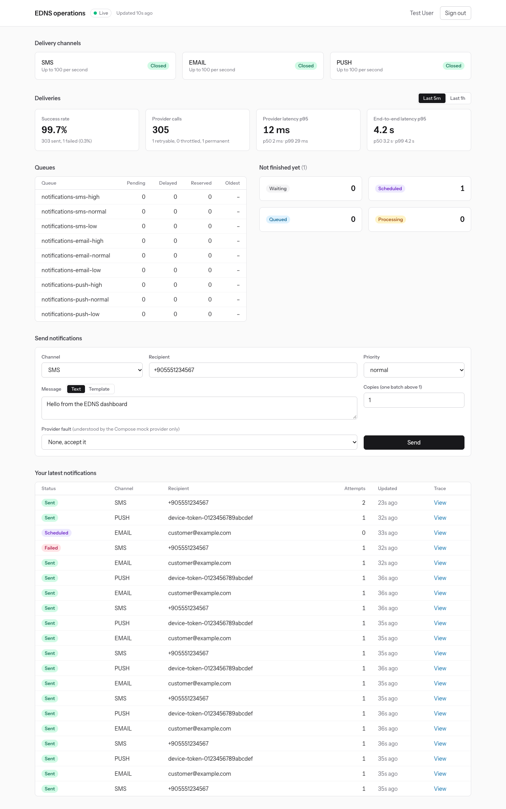
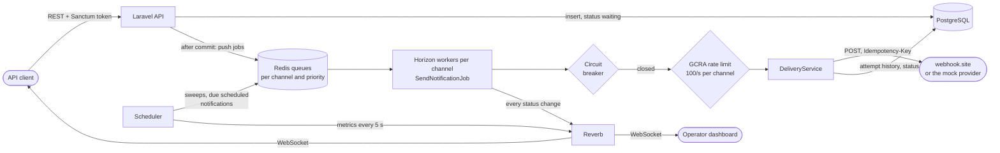
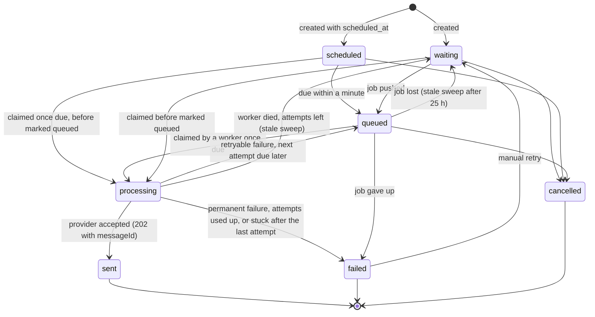
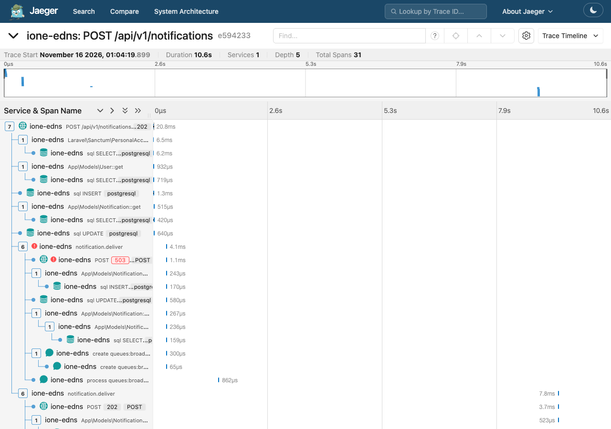

# EDNS — Event-Driven Notification System

[](https://github.com/MrKacmaz/ione-edns/actions/workflows/ci.yml)

EDNS is a Laravel 13 / PHP 8.5 service. It accepts notification requests over a REST API and delivers them as **SMS, email and push** messages through an external provider.

Delivery is asynchronous. It uses priority queues, a rate limit per channel, retries with backoff and a circuit breaker. The service also has idempotency, scheduled sending, templates, real-time status updates over WebSockets, metrics, structured logs, health checks and distributed tracing.



## Contents

- [Requirements coverage](#requirements-coverage)
- [Quick start with Docker](#quick-start-with-docker)
- [Provider](#provider)
- [Architecture](#architecture)
- [Delivery and retry logic](#delivery-and-retry-logic)
- [Design decisions](#design-decisions)
- [API](#api)
- [Real-time updates](#real-time-updates)
- [Observability](#observability)
- [Configuration](#configuration)
- [Tests and CI](#tests-and-ci)
- [Local development without Docker](#local-development-without-docker)
- [Known limitations](#known-limitations)

## Requirements coverage

| Requirement                                                  | Where                                                                                                                                                       |
| ------------------------------------------------------------ | ----------------------------------------------------------------------------------------------------------------------------------------------------------- |
| Create notifications (recipient, channel, content, priority) | `POST /api/v1/notifications`: `NotificationController`, `CreateNotificationsAction`                                                                         |
| Batches of up to 1000                                        | `POST /api/v1/notifications/batch`; one invalid item rejects the batch                                                                                      |
| Status by id or batch id                                     | `GET /api/v1/notifications/{id}`, `GET /api/v1/batches/{id}` (counts per status)                                                                            |
| Cancel pending notifications                                 | `POST /api/v1/notifications/{id}/cancel`, `POST /api/v1/batches/{id}/cancel`                                                                                |
| Filtered, paginated list                                     | `GET /api/v1/notifications` with filters and cursor pagination ([API](#api))                                                                                |
| Asynchronous processing                                      | Redis queues worked by Laravel Horizon: `SendNotificationJob`, `DeliveryService`                                                                            |
| 100 messages per second per channel                          | `RedisGcraRateLimiter` ([ADR 0003](docs/adr/0003-gcra-rate-limiter-per-channel.md))                                                                         |
| Priority queues (high, normal, low)                          | One queue per channel and priority, worked in strict order; normal and low have their own workers ([ADR 0002](docs/adr/0002-priority-queues-on-horizon.md)) |
| Content validation                                           | Recipient format and length limit per channel: `app/Services/Delivery/Channels/*Channel.php`                                                                |
| Idempotency                                                  | `Idempotency-Key` header, `idempotency_key` per notification, atomic claim ([ADR 0004](docs/adr/0004-delivery-guarantees-and-idempotency.md))               |
| Delivery and retry logic                                     | [Delivery and retry logic](#delivery-and-retry-logic), [ADR 0005](docs/adr/0005-retries-and-failure-handling.md)                                            |
| Real-time metrics                                            | `GET /api/v1/metrics`: queue depth, success and failure rates, latency percentiles                                                                          |
| Structured logs with correlation ids                         | JSON logs; `X-Correlation-ID` goes into the jobs and to the provider                                                                                        |
| Health check                                                 | `GET /health`                                                                                                                                               |
| webhook.site provider                                        | `WebhookSiteGateway`; `php artisan notifications:webhook-site` creates the URL ([Provider](#provider))                                                      |
| **Bonus:** failure handling                                  | Circuit breaker per channel, sweeps, manual retry ([ADR 0005](docs/adr/0005-retries-and-failure-handling.md))                                               |
| **Bonus:** scheduled notifications                           | `scheduled_at` up to 30 days ahead ([ADR 0006](docs/adr/0006-scheduled-notifications.md))                                                                   |
| **Bonus:** templates                                         | `/api/v1/templates` with `{{ variable }}` placeholders ([ADR 0007](docs/adr/0007-templates-rendered-at-creation.md))                                        |
| **Bonus:** WebSocket updates                                 | Laravel Reverb: every status change, and a live dashboard ([ADR 0008](docs/adr/0008-real-time-updates-and-observability.md))                                |
| **Bonus:** distributed tracing                               | OpenTelemetry and Jaeger; one notification is one trace ([Observability](#observability))                                                                   |
| **Bonus:** CI/CD                                             | GitHub Actions: checks, tests, an end-to-end run of the Docker stack, images and releases ([Tests and CI](#tests-and-ci))                                   |
| Docker Compose, OpenAPI, migrations, tests                   | `docker-compose.yml`, `spec/openapi.json` and Postman collections in `postman/`, `database/migrations`, Pest tests                                          |

## Quick start with Docker

You need Docker with Compose v2. PHP, Composer, Node, PostgreSQL and Redis run in containers.

**1. Start everything:**

```bash
docker compose up        # or: docker-compose up; add -d to run it in the background
```

Each `up` builds the images from the cache, so it always runs the current code. The one-off `init` service creates the secrets, runs the migrations and seeds an operator with two templates and an API token. The other services wait for it. Until you set a provider URL, deliveries go to the local [mock provider](#mock-provider), and nothing leaves your machine.

| Service                        | URL                                                                                     |
| ------------------------------ | --------------------------------------------------------------------------------------- |
| API                            | http://localhost:8000/api/v1                                                            |
| Operator dashboard             | http://localhost:8000 — sign in as `test@example.com` / `password`                      |
| API documentation (Swagger UI) | http://localhost:8000/docs/api — raw OpenAPI 3.1 at http://localhost:8000/docs/api.json |
| Health                         | http://localhost:8000/health                                                            |
| Horizon                        | http://localhost:8000/horizon (operators only)                                          |
| Jaeger (traces)                | http://localhost:16686                                                                  |
| Reverb (WebSocket)             | ws://localhost:8080                                                                     |
| Mock provider                  | http://localhost:8090/__requests and `/__control`                                       |

To change the host ports, set `APP_PORT`, `REVERB_HOST_PORT`, `JAEGER_UI_PORT` and `MOCK_PROVIDER_PORT`.

**2. Point it at webhook.site**, the provider that the task asks for. This command creates a URL that answers like the provider and prints the line to add:

```bash
docker compose exec app php artisan notifications:webhook-site
```

```bash
echo 'NOTIFICATIONS_GATEWAY_URL=https://webhook.site/<uuid>' >> .env
docker compose up -d
```

**3. Send a notification.** On a local machine the seeded operator has the API token `edns-demo-token`. This token exists only with `APP_ENV=local`, as Docker Compose runs, never in production.

```bash
curl -s -X POST http://localhost:8000/api/v1/notifications \
  -H 'Authorization: Bearer edns-demo-token' -H 'Content-Type: application/json' -H 'Accept: application/json' \
  -d '{"recipient": "+905551234567", "channel": "sms", "content": "Hello from EDNS"}'
```

After a few seconds the request is in your webhook.site inbox, and `GET /api/v1/notifications/{id}` shows `"status": "sent"`. With the mock provider, see http://localhost:8090/__requests or `docker compose logs provider`.

**Run the test suite** in Docker, against its own database:

```bash
docker compose --profile test run --rm tests
```

**Stop**, or stop and delete all data (database, queues, secrets):

```bash
docker compose down
docker compose down -v
```

## Provider

The service sends every notification to `NOTIFICATIONS_GATEWAY_URL` and expects this answer:

```
202 Accepted
{"messageId": "...", "status": "accepted", "timestamp": "..."}
```

Only `202` with a `messageId` counts as accepted. Any other `2xx`, for example webhook.site's default page (`200`), or a `202` without `messageId`, does not confirm the message. The notification is then retried and counts against the channel's circuit.

### webhook.site

**With the command** (recommended): `php artisan notifications:webhook-site` creates a URL that answers `202` with a JSON body. webhook.site fills in `$request.uuid$` for each request, so each delivery gets its own `messageId`. The command prints the URL, its inbox and the `.env` line.

**By hand:**

1. Open https://webhook.site and copy the URL that it creates (`https://webhook.site/<uuid>`).
2. Click **Edit** and set **Default status code** `202`, **Content type** `application/json`, and this **Response body**:
    ```json
    {
        "messageId": "$request.uuid$",
        "status": "accepted",
        "timestamp": "$request.date$"
    }
    ```
3. Add `NOTIFICATIONS_GATEWAY_URL=https://webhook.site/<uuid>` to the `.env` file next to `docker-compose.yml`, then run `docker compose up -d`.
4. Check that `curl -s http://localhost:8000/health` shows `"gateway": {"status": "ok"}`.

Each delivery arrives with the headers `Idempotency-Key` (the notification id), `X-Correlation-ID` and, while tracing is on, `traceparent`.

A free webhook.site URL expires after seven days and accepts a limited number of requests. When it stops, create a new one and replace the line in `.env`. To send the failed notifications again, use `POST /api/v1/notifications/{id}/retry`. To go back to the mock provider, remove the line.

### Mock provider

Without `NOTIFICATIONS_GATEWAY_URL`, deliveries go to the `provider` service, [`docker/mock-provider/server.php`](docker/mock-provider/server.php). It answers like webhook.site, has no request limit, and can fail on request. CI uses it.

- **Idempotency:** a repeated `Idempotency-Key` that it already accepted gets the same `messageId` and counts as a duplicate.
- **Faults for every delivery:** `PUT /__control` changes them while the stack runs; `DELETE /__control` makes it healthy again.
    ```bash
    # 30% of deliveries fail with 503 and Retry-After: 5; each answer takes 200 ms
    curl -X PUT http://localhost:8090/__control -d '{"failure_rate": 0.3, "status": 503, "latency_ms": 200, "retry_after": 5}'
    ```
- **Faults for one message:** put a marker anywhere in the content.

    | Marker             | Answer                                                                      |
    | ------------------ | --------------------------------------------------------------------------- |
    | `[fail:503]`       | `503` to every attempt; any status works; a `2xx` comes without `messageId` |
    | `[fail:503*2]`     | `503` to the first two attempts, then accepted                              |
    | `[slow:1500]`      | Answers after 1.5 seconds; more than 10 seconds is a timeout                |
    | `[retry-after:30]` | Adds `Retry-After: 30` to a failure                                         |

- **What it received:** `GET /__requests` returns the counters (`received`, `accepted`, `duplicates`, `failed` per status), the last 50 deliveries, and the calls per channel and second with each channel's busiest second (`peak_per_second`). `DELETE /__requests` resets them. Each delivery is also one JSON line in `docker compose logs provider`. The state is lost when the container restarts.

## Architecture



1. The API validates a request, stores the notifications in one transaction and answers `202 Accepted`.
2. After the commit, the API pushes one job per notification onto the queue of its channel and priority, for example `notifications-sms-high`. The jobs of one queue go in one Redis round trip.
3. A Horizon worker runs the job through the channel's circuit breaker, then its rate limiter.
4. `DeliveryService` claims the notification, calls the provider, records the attempt and sets the next status.
5. The scheduler repairs what fell between the database and Redis, queues scheduled notifications shortly before their time, and pushes metrics to the dashboard.

Each channel has its own workers, so a channel that waits for send slots does not hold up the others. A batch of 1000 notifications is accepted in about 1.5 s (median of 9 runs, Docker on a laptop), including its 2000 status broadcasts.

### Notification lifecycle



## Delivery and retry logic

The rule is short: **retry only what can still succeed, spread the retries out, never use attempts for waiting, and stop calling a provider that is down.** [ADR 0004](docs/adr/0004-delivery-guarantees-and-idempotency.md) and [ADR 0005](docs/adr/0005-retries-and-failure-handling.md) give the reasons and the rejected options.

### One delivery attempt

1. The job passes the channel's **circuit breaker**, then the **rate limiter**. Neither uses an attempt; they only delay the job.
2. `DeliveryService` **claims** the notification with one conditional `UPDATE` to `processing` and counts the attempt. It claims only a notification that is due: not before `next_attempt_at` after a failure, and not before `scheduled_at`. An early job waits; a duplicate job or a job for a cancelled notification stops.
3. `WebhookSiteGateway` posts `{to, channel, content}` with `Idempotency-Key: <notification id>`, `X-Correlation-ID` and `traceparent`. The connect timeout is 5 seconds, the request timeout 10 seconds.
4. The answer is **classified**. One transaction writes the attempt and the new status.

### How each answer is handled

| Provider answer                     | Outcome   | What happens                                       | Why                                                                            |
| ----------------------------------- | --------- | -------------------------------------------------- | ------------------------------------------------------------------------------ |
| `202` with a `messageId`            | accepted  | `sent`; the `messageId` is stored                  | The provider confirmed the message.                                            |
| Any other `2xx`, or no `messageId`  | retryable | Retried; counts against the circuit                | Not confirmed. A misconfigured URL answers every message the same way.         |
| Timeout or connection error         | retryable | Retried                                            | The network or the provider is briefly unavailable.                            |
| `408`, `5xx`                        | retryable | Retried; `Retry-After` honoured                    | HTTP means "try again later".                                                  |
| `429`                               | throttled | Retried; `Retry-After` honoured; circuit untouched | The provider is up but busy. Metrics show it as `throttled`.                   |
| `401`, `403`, `404`, `410`          | retryable | Retried; counts against the circuit                | The URL or its credentials are wrong, for example an expired webhook.site URL. |
| Any other `4xx` (`400`, `422`, …)   | permanent | `failed` at once                                   | The request is wrong; the same answer comes again.                             |
| An unexpected error in our own code | retryable | Retried and reported                               | The notification must not stay in `processing`.                                |

Errors shown to clients are generic, for example "The provider could not be reached." The full error is in the log, because it contains the provider URL.

### Backoff: exponential with full jitter

After the n-th failed attempt, the next attempt waits a **random** time between zero and `min(300, 30 × 2^(n−1))` seconds, at least one second:

| Failed attempts | Next attempt within    |
| --------------- | ---------------------- |
| 1               | 0–30 s                 |
| 2               | 0–60 s                 |
| 3               | 0–120 s                |
| 4               | 0–240 s                |
| 5               | the notification fails |

The random spread matters: notifications that fail together do not come back together. A provider's `Retry-After` is the minimum wait, capped at one hour. Without it, a notification fails after about 7.5 minutes of waiting at most.

- A retry releases the same job with the delay. The notification's own `attempts` counter decides when to stop. While it waits, the notification is `queued` with `last_error` and `next_attempt_at`.
- A database or Redis outage uses no attempt. Laravel runs the job again after 10, 30, 60 and then every 120 seconds, for up to one day. API requests during an outage get `503` with `Retry-After: 10`.
- `POST /api/v1/notifications/{id}/retry` gives a `failed` notification a new set of attempts and keeps its history.

### Circuit breaker

Each channel has a circuit in Redis, shared by all workers.

- It **opens** when at least 20 calls in 60 seconds were made and at least 50% of them failed in a retryable way. Permanent failures and `429` count as healthy, because the provider answered.
- While it is open, jobs wait without calling the provider and without using attempts. Each job waits a random extra time, so the jobs do not return together.
- After 30 seconds, one **probe** call decides: success closes the circuit, failure opens it again.
- Each change is logged (`notification.circuit.opened` / `closed`) and shown on the dashboard. `/health` reports `warn` while a circuit is open.

### Nothing lost, few duplicates

- The API stores a notification before it pushes the job, and pushes only after the commit. A sweep runs every minute. It pushes `waiting` notifications older than 2 minutes again. It returns `processing` notifications untouched for 5 minutes (a dead worker) to `waiting`. It pushes `queued` notifications whose job was lost after 25 hours.
- Delivery is **at-least-once**. A worker can die after the provider accepted a message but before the result is stored. The message is then sent again with the same `Idempotency-Key`, so a provider that honours the key drops the repeat. The log shows such a case as `notification.delivery.unrecorded`.
- A resend uses an attempt, so a notification is sent at most five times. A notification stuck in `processing` after its last attempt fails, with the reason that the provider may have received it.

### Try it

Use a [mock provider marker](#mock-provider) in the content, or the **Provider fault** in the dashboard's send form. Follow the notification with `GET /api/v1/notifications/{id}` and `docker compose logs -f horizon`.

- `[fail:503]`: retried with growing gaps; fails after the fifth attempt. `[fail:503*2]` is sent on the third attempt.
- `[fail:429]`: retried the same way; recorded as `throttled`; the circuit stays closed.
- `[fail:400]`: fails at once with "The provider responded with HTTP 400."
- `[fail:202]`: retried; the error says that no `messageId` confirmed the delivery.
- `[slow:11000]`: the attempt times out and is retried.
- `[fail:503*5]`: fails all five attempts; `POST /api/v1/notifications/{id}/retry` then sends it.
- The circuit: send `PUT /__control` with `{"failure_rate": 1}`, then send 20 or more notifications of one channel within a minute. The circuit opens. After `DELETE /__control`, the next probe closes it and the waiting notifications go out.

## Design decisions

Each decision has an ADR in [`docs/adr`](docs/adr). Deferred work and its reasons are in [`docs/backlog.md`](docs/backlog.md).

| ADR                                                                              | Decision                                                                                                     |
| -------------------------------------------------------------------------------- | ------------------------------------------------------------------------------------------------------------ |
| [0001](docs/adr/0001-own-notification-model-instead-of-laravel-notifications.md) | An own `Notification` model and delivery pipeline instead of Laravel Notifications, to keep queryable state. |
| [0002](docs/adr/0002-priority-queues-on-horizon.md)                              | Queues and workers per channel and priority, in strict order, with own workers for normal and low.           |
| [0003](docs/adr/0003-gcra-rate-limiter-per-channel.md)                           | A GCRA rate limiter in Redis: evenly spaced sends, a limit per channel, `0` pauses a channel.                |
| [0004](docs/adr/0004-delivery-guarantees-and-idempotency.md)                     | `waiting` as an outbox state, after-commit dispatch, sweeps, and idempotency at three levels.                |
| [0005](docs/adr/0005-retries-and-failure-handling.md)                            | Answer classification, full-jitter backoff, a capped `Retry-After`, and a circuit breaker per channel.       |
| [0006](docs/adr/0006-scheduled-notifications.md)                                 | Scheduled notifications stay in the database until a minute before their time.                               |
| [0007](docs/adr/0007-templates-rendered-at-creation.md)                          | Templates are rendered when a notification is created, and the text is stored on it.                         |
| [0008](docs/adr/0008-real-time-updates-and-observability.md)                     | Every status change over WebSockets, a live dashboard, correlation ids, tracing, metrics and health.         |

## API

All endpoints are under `/api/v1` and need a Sanctum bearer token. Requests and responses are JSON. An account may make 600 requests a minute; more get `429` with `Retry-After`. A request body may be up to 25 MB; a larger one gets `413`. [`spec/openapi.json`](spec/openapi.json) describes every endpoint; you can browse it at `/docs/api`.

```bash
API=http://localhost:8000/api/v1
H=(-H 'Authorization: Bearer edns-demo-token' -H 'Accept: application/json' -H 'Content-Type: application/json')
```

**Create** one notification or a **batch** of up to 1000. Both answer `202 Accepted`. One invalid item rejects the whole batch with `422` and indexed errors, for example `notifications.3.recipient`.

```bash
curl -s "${H[@]}" -X POST "$API/notifications" -d '{"channel": "sms", "recipient": "+905551234567", "content": "Flash sale starts now!", "priority": "high", "idempotency_key": "flash-sale-42"}'

curl -s "${H[@]}" -X POST "$API/notifications/batch" -d '{"notifications": [
  {"channel": "sms", "recipient": "+905551234567", "content": "Your order has shipped."},
  {"channel": "push", "recipient": "a1b2c3d4e5f6a7b8c9d0", "content": "New message", "priority": "low"}
]}'
```

| Channel | Recipient                                | Content limit                                               |
| ------- | ---------------------------------------- | ----------------------------------------------------------- |
| `sms`   | E.164 phone number, e.g. `+905551234567` | One SMS: 160 characters in GSM-7, or 70 when it needs UCS-2 |
| `email` | Email address                            | 10,000 characters                                           |
| `push`  | Device token, 16 to 512 characters       | 240 characters                                              |

An SMS is measured as a carrier measures it. In GSM-7, the characters `€ ^ { } [ ] ~ | \` take two of the 160 places. One character outside GSM-7, for example `ş` or an emoji, makes the whole message UCS-2. Then 70 UTF-16 units fit, and most emoji take two.

**Duplicates:** the same `idempotency_key` with the same notification returns the existing notification with `200`; with different fields it gets `422`. A request with an `Idempotency-Key` header is replayed when it is sent again (`Idempotent-Replayed: true`). A repeat while the first request still runs gets `409`; a repeat with another body gets `422`. An `X-Correlation-ID` (a UUID) comes back in the response and goes into the logs, the jobs and the provider call.

**Schedule** up to 30 days ahead with `scheduled_at` (ISO 8601; without an offset it is UTC), or send from a **template**:

```bash
AT=$(date -u -d '+1 hour' +%FT%TZ 2>/dev/null || date -u -v+1H +%FT%TZ)  # an hour from now (GNU or BSD date)
curl -s "${H[@]}" -X POST "$API/notifications" -d '{"channel": "sms", "recipient": "+905551234567", "content": "Your appointment is in an hour.", "scheduled_at": "'"$AT"'"}'

curl -s "${H[@]}" -X POST "$API/templates" -d '{"name": "delivery-window", "channel": "sms", "content": "Hi {{ name }}, your order {{ order_id }} arrives between {{ from }} and {{ to }}."}'
curl -s "${H[@]}" -X POST "$API/notifications" -d '{"channel": "sms", "recipient": "+905551234567", "template": "delivery-window", "variables": {"name": "Ada", "order_id": 1001, "from": "14:00", "to": "16:00"}}'
```

The demo operator already has the templates `order-shipped` and `invoice-ready`.

**Query, list, cancel and retry:**

```bash
curl -s "${H[@]}" "$API/notifications/{id}"
curl -s "${H[@]}" "$API/batches/{id}"
curl -s "${H[@]}" "$API/notifications?status=failed,queued&channel=sms&created_from=2026-11-14&per_page=50"
curl -s "${H[@]}" -X POST "$API/notifications/{id}/cancel"
curl -s "${H[@]}" -X POST "$API/batches/{id}/cancel"
curl -s "${H[@]}" -X POST "$API/notifications/{id}/retry"
```

- **Filters:** `status`, `channel` and `priority` take one value or several (`status=failed,queued`, or a list). `recipient` must match exactly. `batch_id`, `created_from` and `created_to` (ISO 8601, in UTC; a date alone in `created_to` includes that whole day).
- **Pagination:** cursor based; follow `links.next`.
- **Cancel** is safe to repeat. It gets `409` once the notification is processing or finished. **Retry** gets `409` unless the notification failed.
- Another user's records get `404`. Templates use `GET|POST /templates` and `GET|PATCH|DELETE /templates/{id}`.

### Postman

[`postman/`](postman) has three parts:

- **EDNS API:** every endpoint, generated from the specification. After an API change, `composer postman:sync` generates it again.
- **EDNS Smoke Flow:** an end-to-end check in 22 tested steps. One step reaches the provider. Four steps run only with `mockProvider=true`, as in CI; they cause a permanent failure and a retried delivery.
- **EDNS Local:** the environment. Its `bearerToken` is the local demo token.

```bash
postman collection run "postman/collections/EDNS Smoke Flow" -e "postman/environments/EDNS Local.environment.yaml" --env-var "mockProvider=true"
```

## Real-time updates

The owner of a notification gets an event `.notification.status-changed` on the private channel `App.Models.User.{id}` at every status change: created (`waiting` or `scheduled`), `queued`, `processing`, `queued` again for a retry (with `last_error` and `next_attempt_at`), and `sent`, `failed` or `cancelled`. When many notifications change at once, for example a batch, their broadcasts go to the queue in one Redis round trip.

API clients authorize the channel with their token at `/api/v1/broadcasting/auth`, for example with Laravel Echo:

```js
import Echo from 'laravel-echo';
import Pusher from 'pusher-js';

window.Pusher = Pusher;

const echo = new Echo({
    broadcaster: 'reverb',
    key: 'edns-local-key',
    wsHost: 'localhost',
    wsPort: 8080,
    forceTLS: false,
    enabledTransports: ['ws'],
    authEndpoint: 'http://localhost:8000/api/v1/broadcasting/auth',
    auth: { headers: { Authorization: `Bearer ${token}` } },
});

echo.private(`App.Models.User.${userId}`) // userId: data.id of GET /api/v1/user
    .listen('.notification.status-changed', (event) =>
        console.log(event.notification),
    );
```

The **operator dashboard** at http://localhost:8000 shows each channel's rate limit and circuit, the delivery metrics, the queues and the operator's latest notifications. Metrics refresh every five seconds; statuses and circuits change live.

Its **send form** creates notifications without an API token: a text or a template with variables, a priority, and up to 1000 copies as one batch. A **provider fault** for the mock provider shows a retry or an open circuit as it happens. The form validates like the API and shares its request limit. Each notification in the feed links to its trace in Jaeger.

## Observability

- **Metrics:** `GET /api/v1/metrics` (operators only) returns, for the last 5 minutes and the last hour: queue depth per channel and priority, unfinished notifications per status, attempts (accepted, retryable, throttled, permanent), success and failure rates, and p50/p95/p99 provider and end-to-end latency. It also returns each channel's circuit state.
- **Health:** `GET /health` (no token) checks the database, Redis, Horizon, the gateway URL, the circuits and the paused channels. It answers `200` with `ok`, `200` with `warn` while a circuit is open or a channel is paused, and `503` with `fail`. It fails while Horizon is down, because then nothing is delivered. For a liveness probe, use `GET /up`. A browser gets a status page at the same address: one card per check, refreshed every 10 seconds, with links to the dashboard, Horizon, Jaeger and the API docs. Other clients, such as curl, get JSON. Add `?format=json` to get JSON in a browser.
- **Logs:** JSON lines (`LOG_FORMAT=line` for plain text), for example `notification.delivery.sent`, `notification.delivery.retry_scheduled` and `notification.circuit.opened`. Each line has the notification id, the correlation id and the trace id. In Docker: `docker compose logs -f horizon`.
- **Traces:** OpenTelemetry sends traces of requests, queries, HTTP calls and jobs to Jaeger (service `ione-edns`). **One notification is one trace.** Each delivery attempt is a `notification.deliver` span under the request that created the notification, with the provider call inside it. A notification of a batch gets its own trace, linked to the batch request. Retries, resends and scheduled sends join the same trace, however much later they run. The API returns the trace id as `trace_id`.

    

- **A dead tracing backend does not slow delivery.** PHP sends spans synchronously, so a backend that does not answer holds up each request and worker until a timeout. With Jaeger frozen (`docker compose pause jaeger`), 300 SMS took **169 s instead of 3.8 s**. Now an export gives up after one second without retries. Then the process drops its spans for 30 seconds and tries again with one export ([`ResilientSpanExporter`](app/Services/Observability/ResilientSpanExporter.php)). The same 300 SMS then take **4.8 s**. Workers send their spans between jobs, at most once a second.
- **Queues:** Horizon at `/horizon`, for operators only.

## Configuration

[`config/notifications.php`](config/notifications.php) holds every setting of the notification system and explains it. These settings read environment variables; [`.env.example`](.env.example) lists them:

| Variable                                               | Default   | Meaning                                                                           |
| ------------------------------------------------------ | --------- | --------------------------------------------------------------------------------- |
| `NOTIFICATIONS_GATEWAY_URL`                            | —         | The provider URL; Docker Compose uses the mock provider without it                |
| `NOTIFICATIONS_RATE_LIMIT_PER_SECOND`                  | 100       | Messages per second per channel                                                   |
| `NOTIFICATIONS_{SMS,EMAIL,PUSH}_RATE_LIMIT_PER_SECOND` | the above | The limit of one channel; `0` pauses it, and its jobs wait without using attempts |
| `NOTIFICATIONS_MAX_ATTEMPTS`                           | 5         | Provider attempts before a notification fails                                     |
| `NOTIFICATIONS_BACKOFF_BASE_SECONDS` / `_CAP_SECONDS`  | 30 / 300  | The backoff window after the first failure, and its maximum                       |
| `HORIZON_NOTIFICATION_WORKERS`                         | 20        | Notification workers per channel in production                                    |

## Tests and CI

The Pest tests are in three suites:

| Suite         | Tests | What it covers                                                                                                                                                                                                                                                                                                                              |
| ------------- | ----- | ------------------------------------------------------------------------------------------------------------------------------------------------------------------------------------------------------------------------------------------------------------------------------------------------------------------------------------------- |
| `Unit`        | 121   | Pure logic (data objects, enums, backoff, channels) and architecture rules (`tests/Unit/ArchitectureTest.php`).                                                                                                                                                                                                                             |
| `Feature`     | 758   | Each class and endpoint, against a real PostgreSQL. Code that uses Redis (rate limiter, circuit breaker, queues) runs against a real Redis. The provider's HTTP calls are faked.                                                                                                                                                            |
| `Integration` | 4     | [`tests/Integration`](tests/Integration): real processes working together. Real jobs go through a real queue worker on Redis: high priority goes before normal and low, a worker of one channel leaves other channels alone, a failed attempt waits on the delayed queue, and a cancelled notification's job stops without a provider call. |

The **End-to-end (Docker)** CI job below covers what the suites fake: real HTTP calls to the provider, from the API through Horizon to the mock provider.

```bash
docker compose --profile test run --rm tests   # the whole suite in Docker
php artisan test                               # locally: PostgreSQL with an ione_edns_testing database, and Redis
php artisan test --testsuite=Integration       # only one suite: Unit, Feature or Integration
composer test                                  # Pint, PHPStan and the tests
npm run check && npm run types:check           # frontend formatting, lint and types
```

GitHub Actions ([`.github/workflows/ci.yml`](.github/workflows/ci.yml)) runs on every push and pull request:

| Job                     | What it does                                                                                                                              |
| ----------------------- | ----------------------------------------------------------------------------------------------------------------------------------------- |
| **Quality**             | Pint, PHPStan (Larastan level 8), the frontend build and checks, `composer audit` and `npm audit`                                         |
| **Tests**               | Checks that `spec/openapi.json` matches the code, runs the unit and feature suites in random order, then the integration suite             |
| **End-to-end (Docker)** | Starts the stack with the mock provider, runs the [Postman smoke flow](#postman), and checks that a notification's trace reaches Jaeger   |
| **Publish**             | On `master` and `v*` tags: pushes the `ione-edns-app` and `ione-edns-web` images to GitHub Container Registry; a tag also makes a release |

Dependabot proposes dependency updates every week. Every action is pinned to a commit SHA.

### Load test

[`tests/k6/load.js`](tests/k6/load.js) runs with [k6](https://k6.io) against the Compose stack and the mock provider:

```bash
docker compose --profile loadtest run --rm k6
```

It sends 20 batches of 1000 notifications at the same time, and 9 single notifications a second during the same minute. Then it waits until every notification is finished. The single notifications stay below the demo account's limit of 600 requests a minute. Results on a laptop (Docker Desktop, four workers per channel):

| Measurement                                | Result                                                     |
| ------------------------------------------ | ---------------------------------------------------------- |
| Notifications accepted                     | 20,534; no failed request                                  |
| Delivered to the provider                  | 20,534; no duplicate; nothing unfinished                   |
| Busiest second per channel at the provider | email 99, push 99, sms 94: the limit of 100 a second holds |
| All delivered                              | 102 s after the start, 42 s after the last request         |
| A batch of 1000, 20 at the same time       | p50 12.7 s, p95 14.1 s                                     |
| A single notification during those batches | p50 45 ms, p95 5.3 s                                       |
| Provider call                              | p50 2 ms, p95 7 ms                                         |

The rate limit, not the workers, sets the delivery speed: three channels at about 100 a second. The 20 large batches occupy all 20 PHP-FPM workers of the `app` container, so a single request waits behind them. More `app` replicas or a larger pool would keep that latency low.

### Resilience run

This run uses the Compose stack, with the mock provider answering after 300 ms so that delivery lasts minutes. It sends 3000 notifications. During the delivery it kills every worker process, restarts Redis and PostgreSQL, and makes the provider fail every call for 45 seconds.

| Failure                                          | What happens                                                                                                                         | In the run                                                                                         |
| ------------------------------------------------ | ------------------------------------------------------------------------------------------------------------------------------------ | -------------------------------------------------------------------------------------------------- |
| A worker dies during a delivery (OOM, `kill -9`) | Horizon starts new workers. The dead worker's notifications stay `processing`; after 5 minutes the sweep sends them again.           | 12 worker processes killed; 9 notifications sent again about 5 minutes later.                      |
| Redis restarts                                   | Redis keeps the jobs in its append-only file. Workers retry with backoff. The sweep pushes the notifications whose push failed.      | Delivery went on within seconds; no job was lost.                                                  |
| PostgreSQL restarts                              | The API reconnects. A delivery that cannot be recorded is logged as `notification.delivery.unrecorded` and sent again.               | All 24 API requests during the restart got `200`; 15 deliveries were sent again.                   |
| The provider fails every call                    | Retries with backoff. When half of a channel's calls in 60 seconds fail, the circuit opens and the jobs wait without using attempts. | 587 calls failed; all three circuits opened and closed; no notification used more than 2 attempts. |
| The tracing backend stops answering              | Exports give up after one second and pause for 30 seconds ([Observability](#observability)).                                         | Measured separately: 300 SMS in 4.8 s instead of 169 s.                                            |
| The API dies after storing, before pushing       | The notifications stay `waiting`, and the sweep pushes them after 2 minutes.                                                         | Not in the run; covered by tests.                                                                  |

All 3000 notifications were sent after 354 seconds; most of that time was the wait for the sweep. None failed and none was lost. The provider received 3596 calls: 3000 accepted, 587 failed on purpose, and 9 repeats of accepted messages. The repeats had the same `Idempotency-Key`, so a provider can drop them; delivery is at-least-once.

## Local development without Docker

You need PHP 8.5 with `pdo_pgsql`, `redis` (phpredis), `intl` and `pcntl`, PostgreSQL 18, Redis and Node 22. The `opentelemetry` extension is optional.

```bash
composer install
cp .env.example .env
php artisan key:generate
```

Set the `DB_*` values and `NOTIFICATIONS_GATEWAY_URL` in `.env`, then:

```bash
php artisan migrate --seed
npm install && npm run build
```

Run `php artisan serve`, `php artisan horizon`, `php artisan schedule:work` and `php artisan reverb:start`, each in its own terminal.

## Known limitations

- **At-least-once delivery:** a message whose result was not recorded is sent again. Only a provider that honours `Idempotency-Key` drops the repeat.
- **Redis is needed to accept notifications:** the API's rate limit and the `Idempotency-Key` lock are in Redis, so the API answers `503` while Redis is down. Stored notifications are not lost; the sweep pushes their jobs when Redis is back.
- **webhook.site:** a free URL expires after seven days and limits the number of requests. A URL that you set up by hand with a fixed body gives every notification the same `messageId`.
- **Not a production setup:** Docker Compose runs with `APP_ENV=local`, small worker pools and a demo operator. The published images are not deployed anywhere. Sizing, deployment, data retention and other deferred work are in [`docs/backlog.md`](docs/backlog.md).
