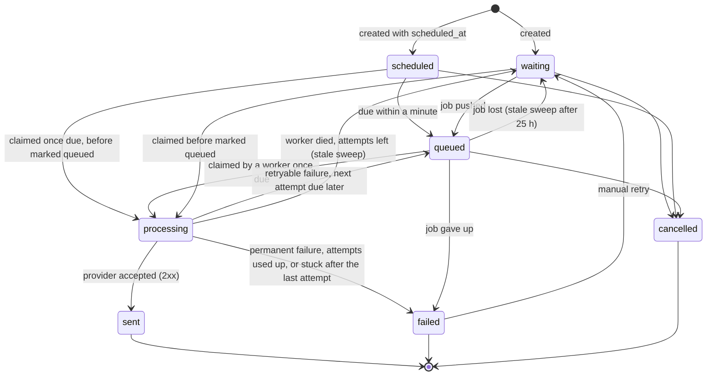

# EDNS — Event-Driven Notification System

[](https://github.com/MrKacmaz/ione-edns/actions/workflows/ci.yml)

A Laravel 13 / PHP 8.5 service that accepts notification requests over a REST API and delivers them asynchronously as **SMS, email and push** messages through an external provider. Delivery runs on prioritised queues with a per-channel rate limit, retries with backoff, a circuit breaker, idempotency at three levels, scheduled sending, templates, real-time status updates over WebSockets, and metrics, structured logs, health checks and distributed tracing.

## Contents

- [Requirements coverage](#requirements-coverage)
- [Quick start with Docker](#quick-start-with-docker)
- [Provider setup (webhook.site)](#provider-setup-webhooksite)
- [Architecture](#architecture)
- [Delivery and retry logic](#delivery-and-retry-logic)
- [Design decisions](#design-decisions)
- [API](#api)
- [Real-time updates](#real-time-updates)
- [Observability](#observability)
- [Configuration](#configuration)
- [Tests and CI](#tests-and-ci)
- [Local development without Docker](#local-development-without-docker)
- [Known limitations](#known-limitations)

## Requirements coverage

| Requirement                                                  | Where                                                                                                                                                                                                |
| ------------------------------------------------------------ | ---------------------------------------------------------------------------------------------------------------------------------------------------------------------------------------------------- |
| Create notifications (recipient, channel, content, priority) | `POST /api/v1/notifications` — `NotificationController`, `CreateNotificationsAction`                                                                                                                 |
| Batches of up to 1000                                        | `POST /api/v1/notifications/batch` — all-or-nothing validation, `notifications.batch.max_size`                                                                                                       |
| Status by id or batch id                                     | `GET /api/v1/notifications/{id}`, `GET /api/v1/batches/{id}` (counts per status)                                                                                                                     |
| Cancel pending notifications                                 | `POST /api/v1/notifications/{id}/cancel`, `POST /api/v1/batches/{id}/cancel`                                                                                                                         |
| Filtered, paginated list                                     | `GET /api/v1/notifications?status=&channel=&batch_id=&created_from=&created_to=` with cursor pagination                                                                                              |
| Asynchronous processing                                      | Redis queues worked by Laravel Horizon — `SendNotificationJob`, `DeliveryService`                                                                                                                    |
| 100 messages per second per channel                          | Own GCRA limiter in Redis — `RedisGcraRateLimiter` ([ADR 0003](docs/adr/0003-gcra-rate-limiter-per-channel.md))                                                                                      |
| Priority queues (high, normal, low)                          | Queues per channel and priority, worked in strict order, with dedicated normal and low workers so neither starves ([ADR 0002](docs/adr/0002-priority-queues-on-horizon.md))                          |
| Content validation                                           | Per-channel recipient formats and length limits — `Services/Delivery/Channels/*Channel`                                                                                                              |
| Idempotency                                                  | `Idempotency-Key` header, per-notification `idempotency_key`, atomic claim ([ADR 0004](docs/adr/0004-delivery-guarantees-and-idempotency.md))                                                        |
| Delivery and retry logic                                     | Retryable vs permanent failures, exponential backoff with full jitter, `Retry-After`, manual retry ([section](#delivery-and-retry-logic), [ADR 0005](docs/adr/0005-retries-and-failure-handling.md)) |
| Real-time metrics                                            | `GET /api/v1/metrics`: queue depth, success rate, latency percentiles                                                                                                                                |
| Structured logs with correlation ids                         | JSON logs, `X-Correlation-ID` carried into jobs and to the provider                                                                                                                                  |
| Health check                                                 | `GET /health`                                                                                                                                                                                        |
| webhook.site provider                                        | `WebhookSiteGateway`, URL in `NOTIFICATIONS_GATEWAY_URL` ([setup](#provider-setup-webhooksite)); a local mock provider until it is set                                                               |
| **Bonus:** failure handling                                  | Per-channel circuit breaker, outbox sweeps ([ADR 0005](docs/adr/0005-retries-and-failure-handling.md))                                                                                               |
| **Bonus:** scheduled notifications                           | `scheduled_at` up to 30 days ahead ([ADR 0006](docs/adr/0006-scheduled-notifications.md))                                                                                                            |
| **Bonus:** templates                                         | `/api/v1/templates`, `{{ variable }}` placeholders ([ADR 0007](docs/adr/0007-templates-rendered-at-creation.md))                                                                                     |
| **Bonus:** WebSocket updates                                 | Laravel Reverb: status events for API clients, live operator dashboard ([ADR 0008](docs/adr/0008-real-time-updates-and-observability.md))                                                            |
| **Bonus:** distributed tracing                               | OpenTelemetry auto-instrumentation exported to Jaeger                                                                                                                                                |
| **Bonus:** CI/CD                                             | GitHub Actions: quality checks, tests against PostgreSQL and Redis, an end-to-end run of the Docker stack, then images and releases ([Tests and CI](#tests-and-ci))                                  |
| Docker Compose, OpenAPI, migrations, tests                   | `docker-compose.yml`, `spec/openapi.json` with Postman collections in `postman/`, `database/migrations`, Pest tests                                                                                  |

## Quick start with Docker

Requirements: Docker with Compose v2. PHP, Composer, Node, PostgreSQL and Redis all run in containers.

**1. Point the service at your provider URL (optional).** Create a webhook.site URL that answers `202` as described in [Provider setup](#provider-setup-webhooksite), then write it into a `.env` file next to `docker-compose.yml`. Without it the stack delivers to its own mock provider, so nothing reaches the outside world.

```bash
echo 'NOTIFICATIONS_GATEWAY_URL=https://webhook.site/<your-uuid>' >> .env
```

**2. Start everything** with one command:

```bash
docker compose up -d --build
```

The one-off `init` service creates the secrets (`APP_KEY`, the Reverb secret), **runs the migrations** and seeds an operator account with two templates; every other service waits for it. There is no manual setup step.

| Service                        | URL                                                                                     |
| ------------------------------ | --------------------------------------------------------------------------------------- |
| API                            | http://localhost:8000/api/v1                                                            |
| Operator dashboard             | http://localhost:8000 — sign in as `test@example.com` / `password`                      |
| API documentation (Swagger UI) | http://localhost:8000/docs/api — raw OpenAPI 3.1 at http://localhost:8000/docs/api.json |
| Health                         | http://localhost:8000/health                                                            |
| Horizon                        | http://localhost:8000/horizon (operators only)                                          |
| Jaeger (traces)                | http://localhost:16686                                                                  |
| Reverb (WebSocket)             | ws://localhost:8080                                                                     |

Host ports can be changed with `APP_PORT`, `REVERB_HOST_PORT` and `JAEGER_UI_PORT`.

**3. Get the API token** that the seeder created, and send a first notification:

```bash
TOKEN=$(docker compose logs --no-log-prefix init | sed -n 's/.*API token for [^:]*: //p' | tail -1)
```

```bash
curl -s -X POST http://localhost:8000/api/v1/notifications \
  -H "Authorization: Bearer $TOKEN" -H 'Content-Type: application/json' -H 'Accept: application/json' \
  -d '{"recipient": "+905551234567", "channel": "sms", "content": "Hello from EDNS"}'
```

Within a few seconds the request shows up in your webhook.site inbox (with the mock provider, in `docker compose logs provider`), and `GET /api/v1/notifications/{id}` reports `"status": "sent"`.

**Run the whole test suite** in Docker, against its own database, with one command:

```bash
docker compose --profile test run --rm tests
```

**Stop**, or stop and delete all data (database, queues, secrets):

```bash
docker compose down
docker compose down -v
```

## Provider setup (webhook.site)

The provider is simulated by [webhook.site](https://webhook.site). The service posts every notification to `NOTIFICATIONS_GATEWAY_URL` and expects the answer the task describes:

```
202 Accepted
{"messageId": "...", "status": "accepted", "timestamp": "..."}
```

1. Open https://webhook.site. It creates a unique URL at once (`https://webhook.site/<uuid>`); copy it.
2. Click **Edit** at the top of the page and set:
    - **Default status code:** `202`
    - **Content type:** `application/json`
    - **Response body:**
        ```json
        {
            "messageId": "7f3c2a1e-0b6d-4c8e-9a51-3d2f6e8b9c40",
            "status": "accepted",
            "timestamp": "2026-11-14T00:00:00Z"
        }
        ```
3. Save, then set the URL in `.env` next to `docker-compose.yml` (or in the Laravel `.env` without Docker):
    ```bash
    NOTIFICATIONS_GATEWAY_URL=https://webhook.site/<your-uuid>
    ```
4. Apply it. Compose recreates the containers whose environment changed:
    ```bash
    docker compose up -d
    ```
5. Check it: `curl -s http://localhost:8000/health` reports `"gateway": {"status": "ok"}`. Every delivery appears in the webhook.site inbox with the headers `Idempotency-Key` (the notification id), `X-Correlation-ID` and, while tracing is on, `traceparent`.

The `messageId` matters: any `2xx` counts as accepted only when the body carries a `messageId`. Without one the provider has not confirmed the message, so the notification fails (see [Delivery and retry logic](#delivery-and-retry-logic)).

A free webhook.site URL expires after seven days and accepts a limited number of requests. When it stops working, create a new one, replace the line in `.env` and run `docker compose up -d` again; notifications that failed in the meantime can be sent again with `POST /api/v1/notifications/{id}/retry`. Remove the line to switch back to the **mock provider**: the `provider` service ([`docker/mock-provider/default.conf`](docker/mock-provider/default.conf)), an nginx container that answers every delivery with `202` and a fresh `messageId`. CI runs the stack this way.

## Architecture


A request is validated, stored in one transaction and answered with `202 Accepted`. Only after the commit are the jobs pushed onto the queue of each notification's channel and priority, for example `notifications-sms-high`; every channel has its own workers, so one channel waiting for send slots never holds up another ([ADR 0002](docs/adr/0002-priority-queues-on-horizon.md)). A Horizon worker passes each job through its middlewares: the channel's circuit breaker, then its rate limiter. `DeliveryService` then claims the notification atomically, calls the provider, records the attempt and moves the notification to its next status. The scheduler repairs anything that fell between the database and Redis, queues scheduled notifications shortly before their time, and pushes metrics to the dashboard.

### Notification lifecycle



## Delivery and retry logic

The task leaves this part to the candidate. The approach in one sentence: **classify every provider answer as accepted, retryable or permanent, retry only what can still succeed, spread retries with exponential backoff and full jitter, never let waiting use up attempts, and stop calling a provider that is down.** The full reasoning, with the options that were rejected, is in [ADR 0004](docs/adr/0004-delivery-guarantees-and-idempotency.md) and [ADR 0005](docs/adr/0005-retries-and-failure-handling.md).

### One delivery attempt

1. The job passes the channel's **circuit breaker**, then the **rate limiter** (100 messages a second per channel). Neither counts as an attempt: an open circuit or a full second only delays the job.
2. `DeliveryService` **claims** the notification with one conditional `UPDATE` to `processing` and counts the attempt, but only once it is due: not before its next attempt after a failure (`next_attempt_at`) and not before its `scheduled_at`. A job that comes early is released until then; a duplicate job, or a job for a cancelled notification, claims nothing and stops.
3. `WebhookSiteGateway` posts `{to, channel, content}` with `Idempotency-Key: <notification id>`, `X-Correlation-ID` and the trace context (`traceparent`), with a 5-second connect timeout and a 10-second request timeout.
4. The answer is **classified**. The attempt (HTTP status, error, duration) and the notification's new status are written in one transaction.

### Transient vs permanent failures

| Provider answer                     | Classified as | What happens                                      | Why                                                                                                                                                                                                                |
| ----------------------------------- | ------------- | ------------------------------------------------- | ------------------------------------------------------------------------------------------------------------------------------------------------------------------------------------------------------------------ |
| `2xx` with a `messageId`            | accepted      | `sent`, the `messageId` is stored                 | The provider confirmed the message.                                                                                                                                                                                |
| `2xx` without a `messageId`         | permanent     | `failed` at once                                  | The message was not confirmed, and a misconfigured endpoint will not start answering correctly on a retry.                                                                                                         |
| Timeout or connection error         | retryable     | Retried with backoff                              | The provider or the network is briefly unavailable; the same request can succeed a moment later.                                                                                                                   |
| `408`, `429`, `5xx`                 | retryable     | Retried with backoff, `Retry-After` honoured      | HTTP defines these as "try again later": a timeout, throttling, or a server-side fault.                                                                                                                            |
| `401`, `403`, `404`, `410`          | retryable     | Retried with backoff, counts against the circuit  | The endpoint or its credentials are wrong (for example an expired webhook.site URL), not the message. Every message would get the same answer, so the circuit opens instead of every notification failing quietly. |
| Any other `4xx` (`400`, `422`, …)   | permanent     | `failed` at once, with the status in `last_error` | The request itself is rejected. Sending it again gives the same answer and wastes the rate limit and the provider's capacity.                                                                                      |
| An unexpected error in our own code | retryable     | Retried with backoff, and reported                | The notification is already claimed; letting the error escape would leave it stuck in `processing`.                                                                                                                |

### Backoff: exponential with full jitter

After the n-th failed attempt the next one waits a **random** time between zero and `min(300, 30 × 2^(n−1))` seconds, and at least one second:

| Failed attempts | Next attempt within      |
| --------------- | ------------------------ |
| 1               | 0–30 s                   |
| 2               | 0–60 s                   |
| 3               | 0–120 s                  |
| 4               | 0–240 s                  |
| 5               | — the notification fails |

A provider's `Retry-After` (delay seconds or an HTTP date, parsed strictly) is a lower bound for the wait, capped at one hour so a wrong header cannot park a notification for days. Without `Retry-After`, the defaults give up on a notification after at most about 7.5 minutes of waiting. The attempts and the backoff window are configurable (`NOTIFICATIONS_MAX_ATTEMPTS`, `NOTIFICATIONS_BACKOFF_BASE_SECONDS`, `NOTIFICATIONS_BACKOFF_CAP_SECONDS`).

**Why full jitter:** when the provider has a problem, many notifications fail in the same second. Plain exponential backoff would send them all back in the same second again and hit the recovering provider with the same spike. Spreading each retry randomly over its window removes the spike without any coordination between workers.

### How retries run

- **A retry releases the same job with the computed delay.** It does not count as a new Laravel attempt. The notification's own `attempts` counter decides when to stop, so waiting for a rate-limit slot or for an open circuit never uses up attempts. Meanwhile the notification is `queued` with the reason in `last_error` and the time of the next attempt in `next_attempt_at`, so no duplicate job can run it sooner. Every call is kept in `notification_attempts`.
- **A database or Redis outage**, like any other unexpected error, uses up no attempt: Laravel runs the job again after 10, 30, 60 and then every 120 seconds until the outage ends or the job's one-day lifetime is over. API requests that meet the outage are answered with `503` and `Retry-After: 10` instead of `500`. When a job gives up, its notification is marked `failed` rather than left behind.
- **Errors shown to clients are generic** ("The provider could not be reached."): the underlying exception names the provider URL, which with webhook.site is the secret that protects the messages. The full message is in the log.
- **Manual retry:** `POST /api/v1/notifications/{id}/retry` gives a `failed` notification a fresh set of attempts and keeps its history.

### When the provider is down: circuit breaker

Retrying every notification on its own schedule keeps hammering a provider that is down and burns every notification's attempts. So each channel has a **circuit breaker** shared in Redis:

- It **opens** when, over the last 60 seconds, at least 20 calls were made and at least 50% of them failed in a retryable way. Permanent failures count as healthy calls, because the provider did answer.
- While it is open, jobs wait without calling the provider and without using attempts. Each job waits the circuit's remaining time plus a random extra of up to the same length, so the jobs held back together come back spread out rather than in the same second.
- After 30 seconds a single **probe** call decides: success closes the circuit, failure opens it again.
- Each change is logged (`notification.circuit.opened` / `closed`) and broadcast to the dashboard. `/health` reports `warn` while a circuit is open.

### Nothing lost, duplicates kept to a minimum

- A notification is stored before its job is pushed, and the push happens only after the commit. Every minute a sweep repairs the gaps: it pushes `waiting` notifications older than 2 minutes again, returns `processing` ones untouched for 5 minutes (a dead worker) to `waiting`, and pushes `queued` ones whose job was lost again after 25 hours.
- Delivery to the provider is **at-least-once**. If a worker dies, or the database goes away, after the provider accepted a message but before the result was recorded, the message is sent again. Every attempt carries `Idempotency-Key: <notification id>`, so a provider that honours the header drops the duplicate. The provider's answer is logged as `notification.delivery.unrecorded` in that case.
- Each resend uses up an attempt, so a notification is sent at most five times even when its outcome can never be recorded. A notification stuck in `processing` after its last attempt **fails** instead of being sent again, with the reason that the provider may have received it.

### Try it

Change the **default status code** of your webhook.site URL, send a notification and follow it with `GET /api/v1/notifications/{id}` (`attempts`, `last_error`, `status`) and `docker compose logs -f horizon` (`notification.delivery.retry_scheduled`):

- `500`, `503` or `429`: the notification is retried with growing gaps and fails after the fifth attempt, a few minutes later.
- `404`: the same, as for an expired URL; with 20 or more calls a minute the channel's circuit opens: the dashboard shows it and `/health` reports `warn`.
- `400`: it fails at once with "The provider responded with HTTP 400." as the error.
- `202` with an empty body: it fails at once as unconfirmed.
- Set it back to `202` with the body above, then `POST /api/v1/notifications/{id}/retry`: it is sent.

## Design decisions

Each decision is recorded as an ADR in [`docs/adr`](docs/adr); deferred work, with the reasons, is in [`docs/backlog.md`](docs/backlog.md).

| ADR                                                                              | Decision                                                                                                                                     |
| -------------------------------------------------------------------------------- | -------------------------------------------------------------------------------------------------------------------------------------------- |
| [0001](docs/adr/0001-own-notification-model-instead-of-laravel-notifications.md) | An own `Notification` model and delivery pipeline instead of Laravel Notifications, because every requirement needs stored, queryable state. |
| [0002](docs/adr/0002-priority-queues-on-horizon.md)                              | Queues and workers per channel and priority, drained in strict order, plus workers that serve only normal or only low so neither starves.    |
| [0003](docs/adr/0003-gcra-rate-limiter-per-channel.md)                           | A GCRA rate limiter in Redis: evenly spaced sends, never more than 100 in any second, short waits kept in place.                             |
| [0004](docs/adr/0004-delivery-guarantees-and-idempotency.md)                     | `waiting` as an outbox state, after-commit dispatch, stale sweeps, and idempotency at request, notification and delivery level.              |
| [0005](docs/adr/0005-retries-and-failure-handling.md)                            | Retryable vs permanent failures, full-jitter backoff, a capped `Retry-After`, and a per-channel circuit breaker.                             |
| [0006](docs/adr/0006-scheduled-notifications.md)                                 | Scheduled notifications stay in the database until a minute before their time, then go out as delayed jobs.                                  |
| [0007](docs/adr/0007-templates-rendered-at-creation.md)                          | Templates are rendered strictly when a notification is created, and the text is stored on the notification.                                  |
| [0008](docs/adr/0008-real-time-updates-and-observability.md)                     | Final statuses over WebSockets, a live operator dashboard, correlation ids, tracing, metrics and health.                                     |

## API

All endpoints live under `/api/v1` and need a Sanctum bearer token; requests and responses are JSON. Each account may make 600 requests a minute (then `429` with `Retry-After`), and a request body may be up to 25 MB (then `413`). Every endpoint, parameter and response code is described in [`spec/openapi.json`](spec/openapi.json), browsable at `/docs/api`, and in the [Postman](#postman) collections.

```bash
API=http://localhost:8000/api/v1
H=(-H "Authorization: Bearer $TOKEN" -H 'Accept: application/json' -H 'Content-Type: application/json')
```

**Create** a notification, or a **batch** of up to 1000. Both answer `202 Accepted`; one invalid item rejects the whole batch with `422` and indexed errors such as `notifications.3.recipient`.

```bash
curl -s "${H[@]}" -X POST "$API/notifications" -d '{"channel": "sms", "recipient": "+905551234567", "content": "Flash sale starts now!", "priority": "high", "idempotency_key": "flash-sale-42"}'

curl -s "${H[@]}" -X POST "$API/notifications/batch" -d '{"notifications": [
  {"channel": "sms", "recipient": "+905551234567", "content": "Your order has shipped."},
  {"channel": "push", "recipient": "a1b2c3d4e5f6a7b8c9d0", "content": "New message", "priority": "low"}
]}'
```

| Channel | Recipient                                | Content limit     |
| ------- | ---------------------------------------- | ----------------- |
| `sms`   | E.164 phone number, e.g. `+905551234567` | 160 characters    |
| `email` | Email address                            | 10,000 characters |
| `push`  | Device token, 16 to 512 characters       | 240 characters    |

**Duplicates:** a repeated `idempotency_key` with the same notification returns the existing one with `200`, with different fields `422`. A request sent with an `Idempotency-Key` header is replayed when it is retried (`Idempotent-Replayed: true`); a retry while the first is still running answers `409`, one with another payload `422`. Its notification answers `waiting`, because the job is pushed only after the stored response is committed. An `X-Correlation-ID` (a UUID) is echoed back and follows the request into the logs, the jobs and the provider call.

**Schedule** up to 30 days ahead with `scheduled_at` (ISO 8601; without an offset it is UTC), or send from a **template** with variables:

```bash
curl -s "${H[@]}" -X POST "$API/notifications" -d '{"channel": "sms", "recipient": "+905551234567", "content": "Your appointment is tomorrow.", "scheduled_at": "2026-11-20T09:00:00+03:00"}'

curl -s "${H[@]}" -X POST "$API/templates" -d '{"name": "order-shipped", "channel": "sms", "content": "Hi {{ name }}, your order {{ order_id }} has shipped."}'
curl -s "${H[@]}" -X POST "$API/notifications" -d '{"channel": "sms", "recipient": "+905551234567", "template": "order-shipped", "variables": {"name": "Ada", "order_id": 1001}}'
```

**Query, list, cancel and retry:**

```bash
curl -s "${H[@]}" "$API/notifications/{id}"
curl -s "${H[@]}" "$API/batches/{id}"
curl -s "${H[@]}" "$API/notifications?status=failed&channel=sms&created_from=2026-11-14&per_page=50"
curl -s "${H[@]}" -X POST "$API/notifications/{id}/cancel"
curl -s "${H[@]}" -X POST "$API/batches/{id}/cancel"
curl -s "${H[@]}" -X POST "$API/notifications/{id}/retry"
```

The list filters by `status`, `channel`, `batch_id`, `created_from` and `created_to` (ISO 8601, compared in UTC; a bare date in `created_to` includes that whole day) and is cursor-paginated: follow `links.next`. Cancelling is safe to repeat and answers `409` once a notification is processing or finished; a retry answers `409` unless the notification failed. Another user's records answer `404`. Templates are managed with `GET|POST /templates` and `GET|PATCH|DELETE /templates/{id}`.

### Postman

[`postman/`](postman) holds the **EDNS API** collection (every endpoint, generated from the specification), the **EDNS Smoke Flow** (an end-to-end check in 18 tested steps, one of which reaches the provider) and the **EDNS Local** environment. Set `bearerToken` in the environment in the Postman app, or run the smoke flow with the [Postman CLI](https://learning.postman.com/docs/postman-cli/postman-cli-overview/):

```bash
postman collection run "postman/collections/EDNS Smoke Flow" -e "postman/environments/EDNS Local.environment.yaml" --env-var "bearerToken=$TOKEN"
```

After an API change, `composer postman:sync` regenerates the specification and the API collection.

## Real-time updates

When a notification reaches `sent`, `failed` or `cancelled`, its owner receives a `.notification.status-changed` event on the private channel `App.Models.User.{id}`. API clients authorize the channel with their token at `/api/v1/broadcasting/auth`, for example with Laravel Echo:

```js
import Echo from 'laravel-echo';
import Pusher from 'pusher-js';

window.Pusher = Pusher;

const echo = new Echo({
    broadcaster: 'reverb',
    key: 'edns-local-key',
    wsHost: 'localhost',
    wsPort: 8080,
    forceTLS: false,
    enabledTransports: ['ws'],
    authEndpoint: 'http://localhost:8000/api/v1/broadcasting/auth',
    auth: { headers: { Authorization: `Bearer ${token}` } },
});

echo.private(`App.Models.User.${userId}`) // userId: data.id of GET /api/v1/user
    .listen('.notification.status-changed', (event) =>
        console.log(event.notification),
    );
```

The operator dashboard at http://localhost:8000 shows queue depth, success rate, latency, circuit states and the signed-in operator's latest notifications, updated every five seconds and on every circuit change.

## Observability

- **Metrics:** `GET /api/v1/metrics` (operators only) returns queue depth per channel and priority, notifications per unfinished status, attempts, success rate and p50/p95/p99 provider and end-to-end latency over the last 5 minutes and hour, and each channel's circuit state.
- **Health:** `GET /health` (no token) checks the database, Redis, Horizon, the gateway configuration and the delivery circuits: `200` with `ok`, `200` with `warn` while a circuit is open, `503` with `fail`. It tells whether notifications are delivered, so it fails while Horizon is down although the API still answers; a liveness probe should use Laravel's `GET /up`.
- **Logs:** JSON lines (`LOG_FORMAT=line` for plain text) such as `notification.delivery.sent`, `notification.delivery.retry_scheduled` and `notification.circuit.opened`, each with the notification id, the correlation id and the trace id. In Docker: `docker compose logs -f horizon`.
- **Traces:** OpenTelemetry traces of requests, queries, HTTP calls and jobs in Jaeger (service `ione-edns`). Each delivery job has its own trace, linked to the request that created it, and passes its context to the provider in the W3C `traceparent` header.
- **Queues:** Horizon at `/horizon`, for operators only.

## Configuration

[`config/notifications.php`](config/notifications.php) holds every setting of the notification system with its value and what it does. The ones an operator is likely to change are read from environment variables, listed in [`.env.example`](.env.example):

| Variable                                              | Default  | Meaning                                                                         |
| ----------------------------------------------------- | -------- | ------------------------------------------------------------------------------- |
| `NOTIFICATIONS_GATEWAY_URL`                           | —        | The provider (webhook.site) URL; Docker Compose falls back to its mock provider |
| `NOTIFICATIONS_RATE_LIMIT_PER_SECOND`                 | 100      | Messages per second per channel                                                 |
| `NOTIFICATIONS_MAX_ATTEMPTS`                          | 5        | Provider attempts before a notification fails                                   |
| `NOTIFICATIONS_BACKOFF_BASE_SECONDS` / `_CAP_SECONDS` | 30 / 300 | Backoff window after the first failure, doubling per attempt, and its cap       |
| `HORIZON_NOTIFICATION_WORKERS`                        | 20       | Notification workers per channel in production                                  |

## Tests and CI

771 Pest tests: unit tests for pure logic (data objects, enums, backoff, channels), feature tests per class and endpoint, and architecture rules (`tests/Unit/ArchitectureTest.php`). Redis-backed code (rate limiter, circuit breaker, queues) is tested against a real Redis.

```bash
docker compose --profile test run --rm tests   # the whole suite in Docker
php artisan test                               # locally: PostgreSQL with an ione_edns_testing database, and Redis
composer test                                  # Pint, PHPStan and the tests
npm run check && npm run types:check           # frontend formatting, lint and types
```

GitHub Actions ([`.github/workflows/ci.yml`](.github/workflows/ci.yml)) runs on every push and pull request:

| Job                     | What it does                                                                                                                                                                                                      |
| ----------------------- | ----------------------------------------------------------------------------------------------------------------------------------------------------------------------------------------------------------------- |
| **Quality**             | Pint, PHPStan, the frontend build and checks, and `composer audit` / `npm audit`                                                                                                                                  |
| **Tests**               | Checks that `spec/openapi.json` matches the code, then runs the suite in random order against PostgreSQL and Redis                                                                                                |
| **End-to-end (Docker)** | Starts the full Compose stack with the mock provider, waits for `/health` and runs the [Postman smoke flow](#postman)                                                                                             |
| **Publish**             | On `master` and `v*` tags, once the jobs above passed: pushes `ione-edns-app` and `ione-edns-web` to GitHub Container Registry (`latest` or the version, and `sha-<commit>`); a tag also creates a GitHub release |

Dependabot proposes weekly dependency updates, and every action is pinned to a commit SHA.

## Local development without Docker

Requirements: PHP 8.5 with `pdo_pgsql`, `redis` (phpredis), `intl` and `pcntl`; PostgreSQL 18; Redis; Node 22. The `opentelemetry` extension is optional.

```bash
composer install
cp .env.example .env
php artisan key:generate
```

Set the `DB_*` values and `NOTIFICATIONS_GATEWAY_URL` in `.env`, then:

```bash
php artisan migrate --seed
npm install && npm run build
```

Run `php artisan serve`, `php artisan horizon`, `php artisan schedule:work` and `php artisan reverb:start`, each in its own terminal.

## Known limitations

- **At-least-once delivery:** a message whose result could not be recorded is sent again; only a provider that honours the `Idempotency-Key` drops the duplicate.
- **Redis is needed to accept notifications:** the API's rate limit and the `Idempotency-Key` lock live in Redis, so while Redis is down the API answers `503`. Notifications stored before are not lost; the sweep pushes their jobs once Redis is back.
- **webhook.site:** the free URL answers every request with the same `messageId`, expires after seven days and limits the number of requests.
- **Not a production setup:** Docker Compose runs with `APP_ENV=local`, small worker pools and a seeded demo operator, and the published images are deployed nowhere. Sizing, deployment, data retention and the other deferred work are in [`docs/backlog.md`](docs/backlog.md).
